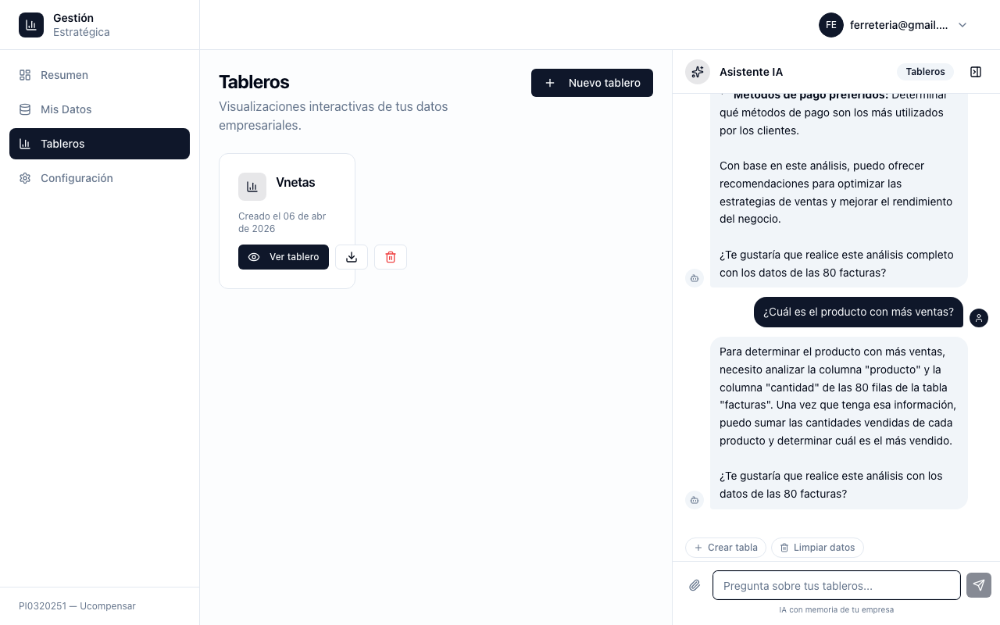
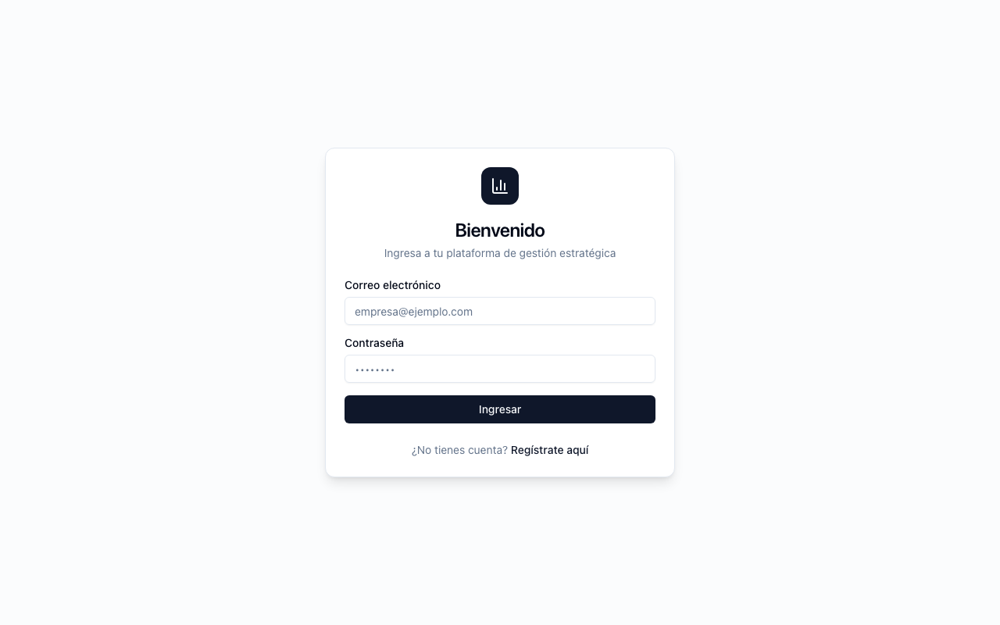

<p align="center">
  
</p>

<h1 align="center">Ucompensar · Dashboard de Gestión con IA</h1>
<p align="center"><b>Gestión estratégica de datos con IA para PYMES colombianas</b></p>
<p align="center"><sub>Nombre de producto pendiente de definir por el equipo — este título es provisional.</sub></p>

<p align="center">
  
  
  
  
  
  
</p>

---

## ¿Qué es esto?

Este proyecto (**PI0320251**, Fundación Universitaria Ucompensar) es una plataforma SaaS multi-tenant pensada para que una PYME colombiana sin equipo técnico pueda: subir sus datos de negocio (Excel, CSV), ver dashboards generados automáticamente, y preguntarle a un asistente de IA sobre su propia información — sin escribir una sola línea de SQL.

Cada organización que se registra obtiene su propia base de datos aislada, con tablas ya adaptadas a su tipo de negocio (ferretería, servicios, etc.).

## Vista previa

<p align="center">
  
  &nbsp;&nbsp;
  
</p>
<p align="center">
  
  &nbsp;&nbsp;
  
</p>

## Cómo funciona

```
Usuario se registra → elige tipo de negocio → se crea su BD dedicada con tablas estándar
        ↓
Sube un archivo (CSV/Excel, incluso con varias hojas) → el sistema detecta columnas
y las mapea automáticamente a la tabla que corresponda (o crea una nueva si no encaja)
        ↓
Los datos quedan disponibles al instante en Dashboards (gráficas automáticas)
y en el Chat con IA (Gemini), que responde preguntas usando los datos reales de la org
```

## Stack tecnológico

| Capa | Tecnología |
|---|---|
| Frontend | Next.js 14 (App Router) · TypeScript · Tailwind CSS · shadcn/ui · TanStack Query · Recharts |
| Backend | FastAPI · Python 3.13 · asyncpg · JWT propio (cookies HttpOnly) |
| Base de datos | PostgreSQL 15 — una base de datos dedicada por organización (multi-tenant real) |
| IA | Google Gemini (`gemini-3.6-flash`) vía `google-genai`, para el chat conversacional |
| Testing | pytest (backend) · Vitest + Playwright (frontend) |

## Puesta en marcha rápida

**Requisitos**: Docker, Node.js + `pnpm` (`corepack enable`), Python 3.11+.

```bash
# 1. Postgres local
docker run --name ucompensar-postgres -e POSTGRES_PASSWORD=postgres \
  -e POSTGRES_DB=pi_main -p 5433:5432 -d postgres:15-alpine

# 2. Backend
cd backend
python -m venv venv && source venv/Scripts/activate   # o venv/bin/activate en Linux/Mac
pip install -r requirements.txt
pip install -r ../agents/requirements.txt              # agents/ se importa en el mismo proceso
# crear backend/.env con las variables de la siguiente seccion
uvicorn main:app --reload --port 8000

# 3. Frontend (en otra terminal)
cd frontend
pnpm install
# crear frontend/.env.local con la variable de la siguiente seccion
pnpm dev
```

Abre `http://localhost:3000` para la app y `http://localhost:8000/docs` para la API interactiva (Swagger).

**`backend/.env`**:

```bash
DATABASE_HOST=localhost
DATABASE_PORT=5433
DATABASE_PASSWORD=postgres
APP_SECRET_KEY=<generar con: python -c "import secrets; print(secrets.token_urlsafe(48))">
GOOGLE_API_KEY=<obtener en aistudio.google.com/apikey>
GEMINI_MODEL=gemini-3.6-flash
```

**`frontend/.env.local`**:

```bash
NEXT_PUBLIC_API_URL=http://localhost:8000
```

## Estructura del repositorio

```
backend/    FastAPI — routers, servicios, modelos, tests
agents/     Pipeline de agentes con Google ADK (en evolución activa)
frontend/   Next.js — app, componentes, hooks, tests E2E
test-data/  CSVs de ejemplo para probar la carga de datos
docs/       Branding e imágenes
```

## Estado del proyecto

Los flujos centrales funcionan de punta a punta: registro y multi-tenancy, carga inteligente de archivos (con matching automático de columnas, sin necesidad de LLM), dashboards con gráficas generadas dinámicamente, y chat con IA sobre datos reales de la organización. El proyecto sigue en desarrollo activo — hay módulos en evolución y decisiones de arquitectura en curso.

## Equipo

Proyecto del semillero de investigación **Data Core Tech** — Fundación Universitaria Ucompensar.

## Contribuir

- Commits en formato [Conventional Commits](https://www.conventionalcommits.org/) (`feat:`, `fix:`, `chore:`, `test:`, `docs:`).
- Un commit por cambio lógico — evita mezclar varios arreglos en uno solo.
- Rama por tarea + Pull Request antes de fusionar a `main`.
