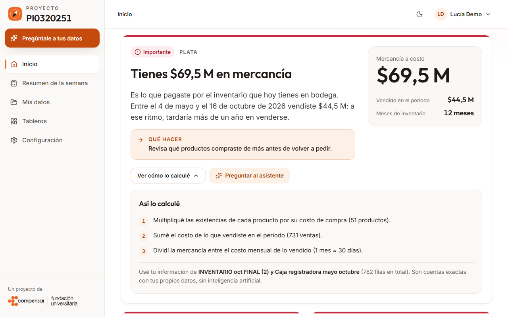
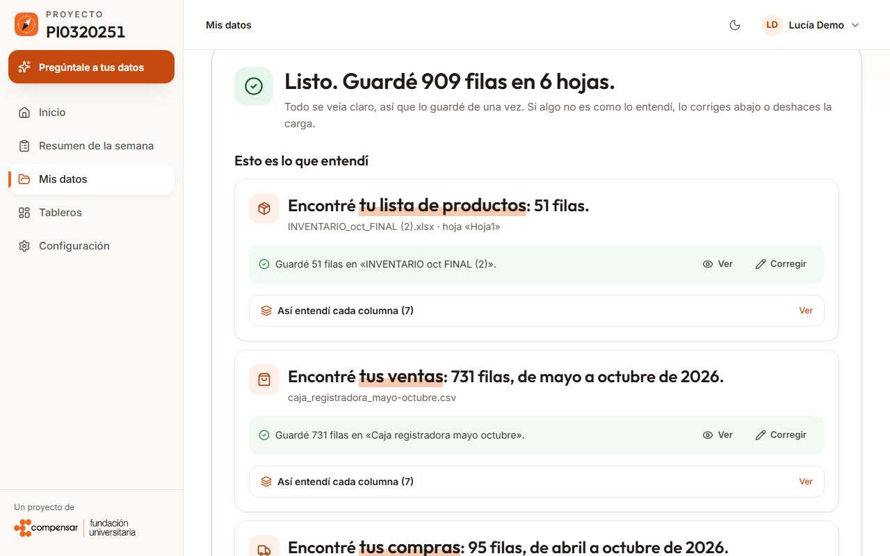
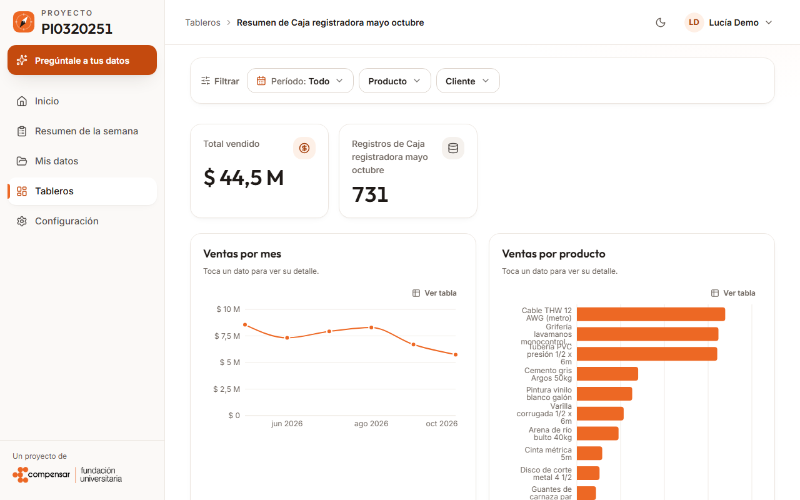
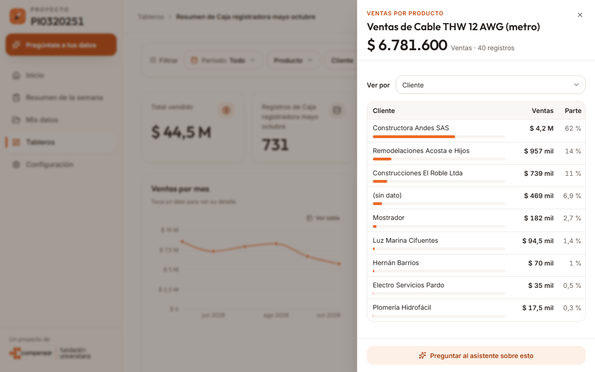
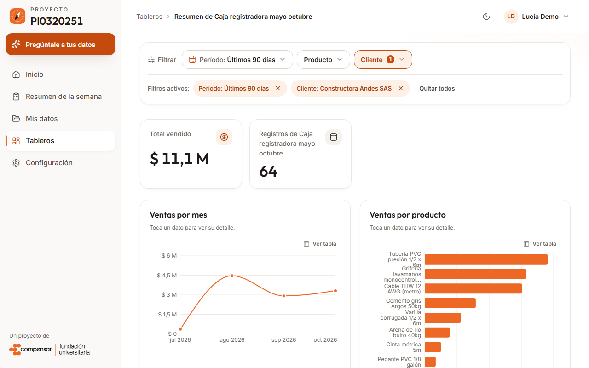
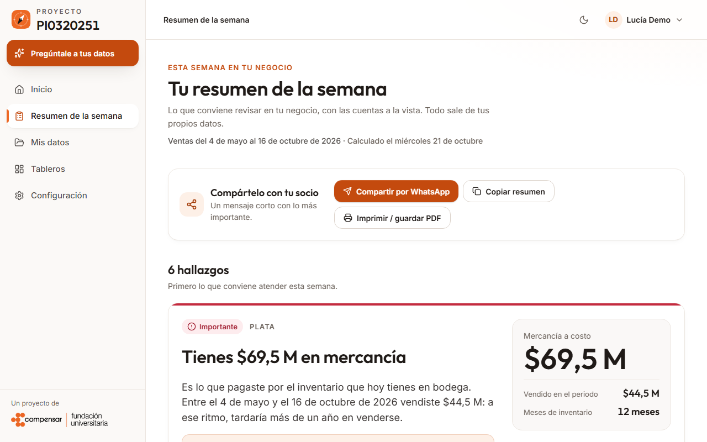
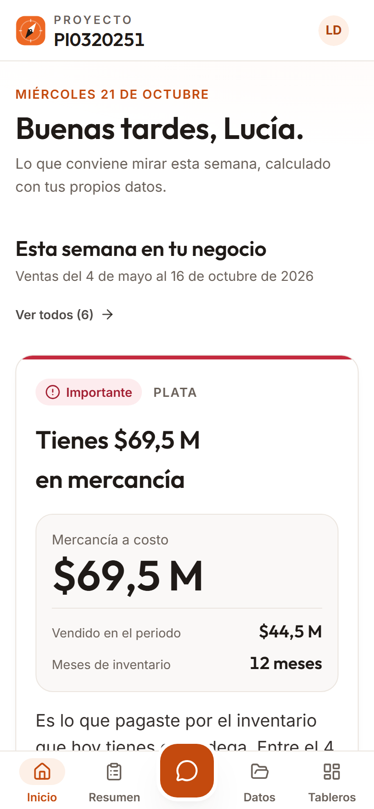
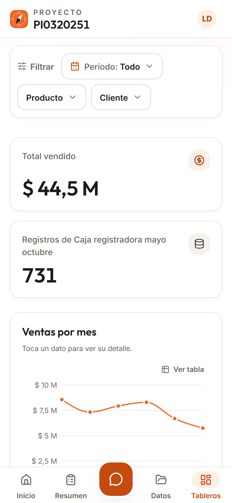

<p align="center">
  
</p>

<h1 align="center">Ucompensar · Dashboard de Gestión con IA</h1>
<p align="center"><b>Gestión estratégica de datos con IA para PYMES colombianas</b></p>

<p align="center">
  
  
  
  
  
  
</p>

---

> **¿Vienes de la versión anterior?** Lee primero [docs/ACTUALIZACION.md](docs/ACTUALIZACION.md): qué cambió, qué ya no existe y cómo actualizar tu copia local.

## ¿Qué es esto?

Este proyecto (**PI0320251**, Fundación Universitaria Ucompensar) es una plataforma SaaS multi-tenant pensada para que una PYME colombiana sin equipo técnico pueda subir sus datos de negocio (Excel, CSV), recibir hallazgos y tableros generados a partir de ellos, y preguntarle a un asistente de IA sobre su propia información, sin escribir una sola línea de SQL.

Cada organización que se registra obtiene su propia base de datos aislada.

## Qué hace

- **Carga inteligente.** El dueño suelta varios archivos (CSV, Excel, incluso con varias hojas) en una sola zona. El sistema identifica qué es cada hoja (ventas, compras, productos, etc.) y el rol de cada columna, lo explica en lenguaje simple, permite corregirlo y permite **deshacer** la carga. Las reglas deterministas resuelven lo evidente; Gemini solo interviene en hojas ambiguas.
- **Hallazgos de negocio.** Cálculos exactos, sin IA, sobre los datos cargados (mercancía parada, productos por agotarse, margen bajo, concentración de clientes), con el cálculo a la vista.
- **Tableros creados por IA.** Se piden al asistente o se sugieren a partir de los datos. Cada gráfica se calcula sobre todas las filas.
- **Edición con deshacer.** El asistente modifica un tablero existente; cada edición guarda una versión que se puede revertir.
- **Detalle al clic y filtros.** Los gráficos son clicables y abren los registros que componen el dato. Los filtros de periodo y categorías viven en la URL.
- **Chat con herramientas.** El asistente consulta los datos con herramientas de solo lectura: el modelo nunca escribe SQL ni recibe el identificador de la organización.

## Vista previa

<p align="center">
  
  
</p>
<p align="center">
  <sub><b>Hallazgos</b> con el cálculo a la vista &nbsp;·&nbsp; <b>Carga inteligente</b>: varios archivos a la vez</sub>
</p>

<p align="center">
  
  
</p>
<p align="center">
  <sub><b>Tablero</b> con barra de filtros &nbsp;·&nbsp; <b>Detalle al clic</b> en un dato</sub>
</p>

<p align="center">
  
  
</p>
<p align="center">
  <sub><b>Filtros aplicados</b>: las cifras se recalculan &nbsp;·&nbsp; <b>Resumen de la semana</b></sub>
</p>

<p align="center">
  
  &nbsp;&nbsp;
  
</p>
<p align="center"><sub>En móvil</sub></p>

> Capturas tomadas con datos ficticios, con el demo local y sin Gemini.

## Cómo funciona

```
Usuario se registra → elige tipo de negocio → se crea su BD dedicada
        ↓
Suelta uno o varios archivos → el agente de esquema propone el tipo de cada hoja y el rol
de cada columna → el usuario revisa o corrige solo si hay dudas → se guarda (y se puede deshacer)
        ↓
Inicio y Resumen: hallazgos calculados de forma exacta
Tableros: sugeridos o pedidos al asistente; gráficos clicables, filtros y edición con deshacer
Chat con IA (Gemini): consulta los datos reales con herramientas de solo lectura
```

## Stack tecnológico

| Capa | Tecnología |
|---|---|
| Frontend | Next.js 14 (App Router) · TypeScript · Tailwind CSS · shadcn/ui · TanStack Query · Recharts |
| Backend | FastAPI · Python 3.11+ (CI usa 3.13) · asyncpg · JWT propio (cookies HttpOnly) |
| Base de datos | PostgreSQL (CI usa 18) — una base de datos dedicada por organización (multi-tenant real) |
| IA | Google Gemini (`gemini-3.6-flash`) vía `google-genai`: chat con herramientas, carga inteligente y tableros |
| Testing | pytest (backend) · Vitest + Playwright (frontend) · GitHub Actions |

## Puesta en marcha rápida

**Requisitos**: Docker, Node.js + `pnpm` (`corepack enable`), Python 3.11+.

```bash
# 1. Postgres local
docker run --name ucompensar-postgres -e POSTGRES_PASSWORD=postgres \
  -e POSTGRES_DB=pi_main \
  -e POSTGRES_INITDB_ARGS="--encoding=UTF8 --locale=C --locale-provider=builtin --builtin-locale=C.UTF-8" \
  -p 5433:5432 -d postgres:18

# 2. Backend
cd backend
python -m venv venv && source venv/Scripts/activate   # o venv/bin/activate en Linux/Mac
pip install -r requirements.txt
# crear backend/.env con las variables de la siguiente seccion
uvicorn main:app --reload --port 8000

# 3. Frontend (en otra terminal)
cd frontend
pnpm install
# crear frontend/.env.local con la variable de la siguiente seccion
pnpm dev
```

Abre `http://localhost:3000` para la app y `http://localhost:8000/docs` para la API interactiva (Swagger).

Las búsquedas sin distinguir mayúsculas dependen del *locale* de Postgres; por eso el comando de arriba inicializa la base con `C.UTF-8` (la misma configuración que usa CI). Si usas otra instalación, verifica:

```sql
SELECT lower('ÑANDÚ') = 'ñandú';   -- debe dar true
```

**`backend/.env`**:

```bash
DATABASE_HOST=localhost
DATABASE_PORT=5433
DATABASE_PASSWORD=postgres
APP_SECRET_KEY=<generar con: python -c "import secrets; print(secrets.token_urlsafe(48))">
GOOGLE_API_KEY=<opcional; obtener en aistudio.google.com/apikey>
GEMINI_MODEL=gemini-3.6-flash
```

`APP_SECRET_KEY` es la única variable obligatoria (mínimo 32 caracteres). Sin `GOOGLE_API_KEY` la app arranca, pero el asistente responde con un mensaje de respaldo. El resto de variables (límites de uso, tiempos de espera, etc.) tienen valor por defecto: consulta [backend/app/config.py](backend/app/config.py).

**`frontend/.env.local`**:

```bash
NEXT_PUBLIC_API_URL=http://localhost:8000
```

### Pruebas

```bash
# Backend (desde backend/)
python -m pytest -q          # las pruebas que necesitan Postgres desechable se omiten solas

# Frontend (desde frontend/)
pnpm vitest run
pnpm exec tsc --noEmit
```

## Estructura del repositorio

```
backend/    FastAPI: routers, servicios, tests y scripts de mantenimiento (backend/scripts/)
agents/     Pipeline experimental con Google ADK (ninguna pantalla lo usa hoy)
frontend/   Next.js: app, componentes, hooks, tests; guía de convenciones en frontend/CLAUDE.md
test-data/  CSVs de ejemplo para probar la carga de datos
docs/       Plan de trabajo, artículo de la ponencia, guía de actualización, branding e imágenes
.github/    Flujo de integración continua
```

## Estado del proyecto

Los flujos centrales funcionan de punta a punta: registro y multi-tenancy, carga inteligente, hallazgos, tableros creados y editados por el asistente, y chat con IA sobre datos reales de la organización. El proyecto sigue en desarrollo; las limitaciones conocidas están en [docs/ACTUALIZACION.md](docs/ACTUALIZACION.md#5-limitaciones-conocidas).

## Equipo

Proyecto del semillero de investigación **Data Core Tech** — Fundación Universitaria Ucompensar.

## Contribuir

- Commits en formato [Conventional Commits](https://www.conventionalcommits.org/) (`feat:`, `fix:`, `chore:`, `test:`, `docs:`).
- Un commit por cambio lógico: evita mezclar varios arreglos en uno solo.
- Rama por tarea + Pull Request antes de fusionar a `main`.
- Para reportar un problema, abre un issue con los datos que pide [docs/ACTUALIZACION.md](docs/ACTUALIZACION.md#6-cómo-reportar-un-problema).
