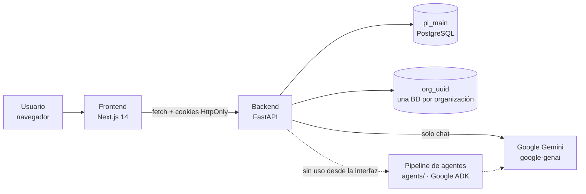
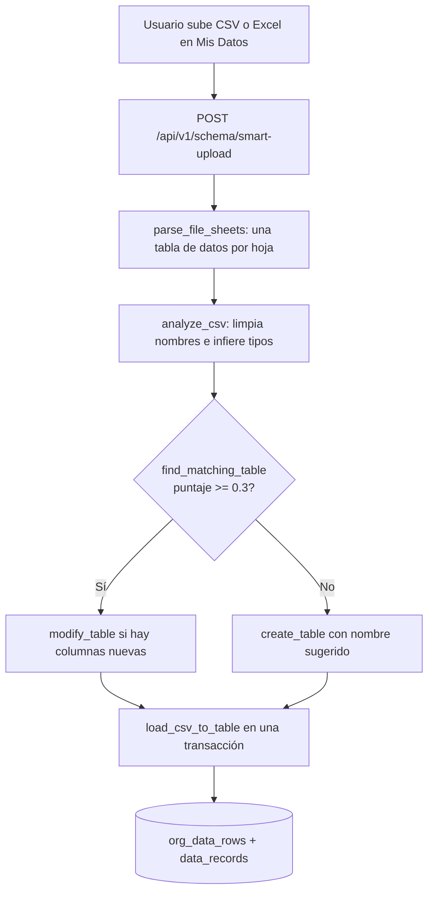
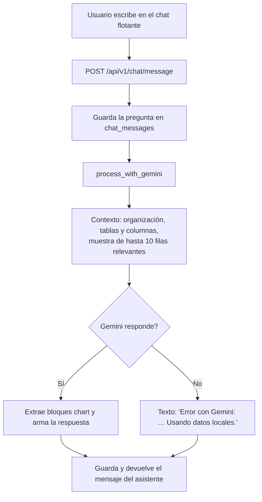
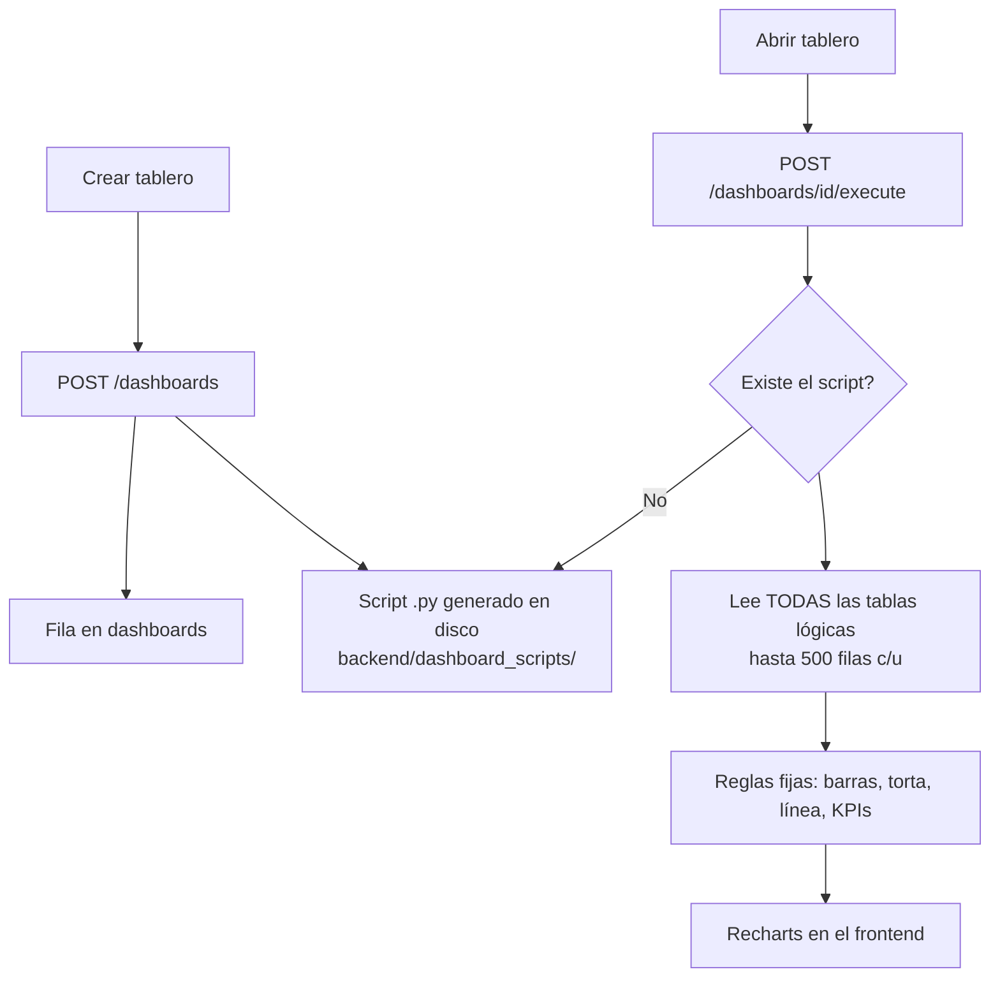
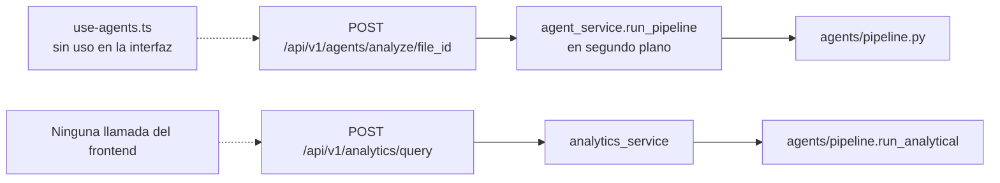

# Arquitectura del Sistema — PI0320251

**Responsable**: Pasante 2 — Documentación
**Sprint**: 2 (5–9 de octubre de 2026)
**Issue relacionado**: #7 (ARCHITECTURE.md con el mapa real del sistema) y #1 (decisión sobre el pipeline de IA)
**Versión del código analizada**: `main` @ `8ba65d7`
**Método**: lectura del código, búsqueda de quién llama a cada módulo (backend → servicios, frontend → endpoints) y ejecución de los flujos en entorno local el 6 de octubre de 2026

> Este documento describe lo que **realmente** está conectado, no lo que el nombre de cada módulo sugiere. Cada afirmación de "conectado" o "desconectado" se verificó buscando quién llama a qué. Lo que depende del entorno de producción y no pudo comprobarse localmente se marca **[a verificar en producción]**.

---

## 1. Vista general

| Capa | Tecnología | Carpeta | Producción |
|---|---|---|---|
| Frontend | Next.js 14 (App Router), TypeScript, Tailwind, shadcn/ui, TanStack Query, Recharts | `frontend/` | Proyecto de Vercel |
| Backend | FastAPI, asyncpg, JWT propio | `backend/` | Proyecto de Vercel separado (serverless) |
| Base de datos | PostgreSQL 15: `pi_main` + una base `org_<uuid>` por organización | — | Neon |
| IA conversacional | Google Gemini (`gemini-3.6-flash`) vía `google-genai` | `backend/app/services/agent_tools_service.py` | Requiere `GOOGLE_API_KEY` |
| Pipeline de agentes | Google ADK (`SequentialAgent`) | `agents/` | **Desconectado** (sección 4) |

El repositorio no contiene archivos de despliegue (`vercel.json`, `Dockerfile`): la configuración de los dos proyectos de Vercel vive en sus paneles. Ver `docs/SECURITY.md` (sección de cookies) sobre por qué tener dos dominios obliga a usar `SameSite=None`.

---

## 2. Mapa de funcionalidades

| Funcionalidad | Estado | Frontend | Backend | Notas |
|---|---|---|---|---|
| Registro e inicio de sesión | **Funciona** | `(auth)/login`, `(auth)/register`, `use-auth.ts` | `auth_router.py` | Issue #3: el registro crea tablas de "servicios" además del tipo elegido |
| Tipos de negocio | **Funciona** | `use-templates.ts`, `BusinessTypeSelector` | `templates.py`, `template_service.py` | |
| Carga inteligente de archivos (CSV, Excel multi-hoja, JSON) | **Funciona** | `(dashboard)/data` → `/schema/smart-upload` | `schema.py`, `schema_agent_service.py` | Determinística, sin LLM |
| Gestión de tablas y filas | **Funciona** | `(dashboard)/data` | `schema.py` | Ver `docs/API.md` §5 |
| Lista y borrado de archivos subidos | **Funciona** | `(dashboard)/data` (`useFiles`, `useDeleteFile`) | `files.py` | |
| Vista previa de un archivo | **No funciona** | `useFilePreview` llama `/files/{id}/preview`, que no existe (y el hook no se usa) | `GET /files/{id}` devuelve `preview_rows` siempre vacío | Filtra `data_records` por el id del archivo, pero la carga guarda ahí el nombre de la tabla |
| Plantillas y exportación CSV/Excel | **Funciona** | `(dashboard)/data` | `schema.py` | |
| Resumen del negocio | **Funciona con error** | `(dashboard)/page.tsx` | `templates.py`, `etl.py` | El contador "Archivos" lee `etl_jobs`, que la carga actual no llena: siempre 0 |
| Tableros: crear, listar, borrar | **Funciona** | `(dashboard)/dashboards`, `use-dashboards.ts` | `dashboards.py` | |
| Tableros: gráficas | **Funciona parcialmente** | `dashboards/[id]` → `/execute` | `dashboard_script_service.py` | Las gráficas se calculan igual para todos los tableros; ignoran widgets y script (§3.3) |
| Script Python del tablero | **Desconectado** | Ver y descargar | `dashboard_script_service.py` | Se genera y guarda, pero **nunca se ejecuta** |
| Chat con IA | **Funciona** (con API key) | `floating-chat.tsx`, `use-floating-chat.ts` | `chat.py`, `chat_service.py`, `agent_tools_service.py` | Sin respuesta local real cuando Gemini falla (§3.2) |
| Carga de archivos desde el chat | **Funciona** | `floating-chat.tsx` → `/chat/upload` | `chat_service.send_file_message` | Solo la primera hoja de un Excel |
| Soporte PDF | **No implementado** | El chat acepta `.pdf` | Rechaza el PDF | Issue #2 (en curso, Sprint 2) |
| Pipeline de insights automáticos | **Desconectado** | `use-agents.ts` existe pero no se usa | `agents.py`, `agent_service.py`, `agents/` | Issue #1 (§4) |
| Consultas analíticas con IA | **Desconectado** | Ninguna llamada | `analytics.py`, `analytics_service.py` | Usa `agents/` (`run_analytical`) |
| Carga ETL clásica | **Parcial** | `use-etl.ts` (solo lista de trabajos) | `etl.py` | Ruta paralela a smart upload; solo se usa para el contador |
| Configuración de perfil | **No funciona** | `(dashboard)/settings` llama `PUT /api/v1/auth/me` | Solo existe `PUT /api/v1/auth/profile` | Guardar el perfil responde **405 Method Not Allowed** (verificado) |
| Health check | **Funciona** | — | `health.py` (`/api/health`, `/api/health/detailed`) | |

---

## 3. Flujos principales

### 3.1 Carga inteligente de un archivo

Todo el flujo es **determinístico**: no llama a ningún modelo de lenguaje. Fue una decisión de diseño de la Fase 1 para controlar el costo y la latencia.

### 3.2 Chat con IA

Lo que **no** está conectado en este flujo:

| Código | Situación |
|---|---|
| `chat_service._call_gemini`, `_build_context` | Sin llamadas: el flujo usa `agent_tools_service.process_with_gemini` |
| `chat_service._local_chat_response` (respuesta local con datos reales) | Solo la llama `_call_gemini`, que no se usa. Por eso, cuando Gemini falla, no hay respuesta local real |
| `agent_tools_service.analyze_table`, `create_chart`, `manage_data` | Definidas como "tools", pero nunca se pasan a Gemini ni se llaman |
| `agents/chat_agent.py` (ChatAgent de ADK) | No lo usa el chat |
| Campo `file_id` de `/chat/message` | Se recibe y se ignora |

Relación con el plan: el Issue #4 (parte 2) pide pruebas de que, si Gemini falla, el chat use la respuesta local. Con el código actual esa prueba fallaría.

### 3.3 Tableros

- El contenido del script **no se lee**: `/execute` solo comprueba que el archivo exista. Editarlo o reemplazarlo (`PUT …/script`) no cambia nada, aunque su encabezado ofrece una función `query(sql)`.
- Los widgets se guardan en la tabla `widgets`, pero `/execute` no los consulta: **todos los tableros de una organización muestran las mismas gráficas**.
- En Vercel el disco es efímero, así que el script se pierde entre invocaciones y se regenera automáticamente. Como no se ejecuta, no hay impacto funcional. **[a verificar en producción]**

---

## 4. Pipeline de IA de insights automáticos (Issue #1)

### 4.1 Qué es

`agents/` contiene un pipeline construido con Google ADK, a cargo de Desarrollador 1:

| Agente | Archivo | Rol previsto |
|---|---|---|
| ETLAgent | `etl_agent.py` | Extraer y normalizar el archivo |
| DataCleanerAgent | `data_cleaner_agent.py` | Limpiar datos |
| DataAnalyzerAgent | `data_analyzer_agent.py` | Estadísticas y patrones |
| InsightGeneratorAgent | `insight_generator_agent.py` | Hallazgos en lenguaje natural |
| DashboardConfigAgent | `dashboard_config_agent.py` | Proponer la configuración de un tablero |
| ChatAgent | `chat_agent.py` | Conversación (no usado) |
| AnalyticalAgent | `analytical_agent.py` | Consultas analíticas |

`pipeline.py` los orquesta con un `SequentialAgent` (limpieza → análisis → insights → configuración de tablero). Todos usan `GEMINI_MODEL`.

### 4.2 Cómo está conectado hoy

- **Ninguna pantalla** dispara el pipeline: el hook `use-agents.ts` no se importa en ningún componente, y `/analytics` no tiene llamadas desde el frontend.
- El backend importa `agents/` agregando la carpeta al `sys.path` en tiempo de ejecución (`agent_service.py`, `analytics_service.py`). Si el proyecto de backend en Vercel solo despliega `backend/`, el pipeline no estaría disponible en producción. **[a verificar en producción]**
- `agents/tests/test_pipeline.py` no se puede ejecutar: importa `query_data` desde `agents.chat_agent`, donde ya no existe. Las demás pruebas de `agents/` pasan.
- Las tablas `agent_sessions` y `agent_results` de cada organización solo las usa este pipeline.

### 4.3 Resolución del Issue #1

> **Pendiente de registrar.** Al 6 de octubre de 2026 el repositorio no contiene la decisión (reconectar o eliminar). Cuando Desarrollador 1 la documente en el Issue #1, debe copiarse aquí con su fecha y su justificación.

Evidencia técnica para la decisión:

| Si se **reconecta** | Si se **elimina** |
|---|---|
| Agregar un punto de entrada en la interfaz (ej. un botón "Generar insights" tras la carga) | Borrar `agents/`, `routers/agents.py`, `routers/analytics.py`, `agent_service.py`, `analytics_service.py` y `use-agents.ts` |
| Garantizar que `agents/` se despliegue con el backend | Quitar `google-adk` de `requirements.txt` |
| Arreglar `test_pipeline.py` | Decidir qué hacer con `agent_sessions` y `agent_results` |
| Cada carga de archivo implicaría varias llamadas a Gemini (costo) | Mantiene el principio de la Fase 1: núcleo determinístico, IA solo en el chat |
| | Simplifica el Issue #9 (limpieza de código muerto) |

---

## 5. Inventario de código sin uso

Insumo para el **Issue #9** (Desarrollador 2, viernes del Sprint 2). Verificado buscando importaciones y llamadas.

| Tipo | Elemento | Verificación |
|---|---|---|
| Hook | `frontend/src/hooks/use-agents.ts` | 0 importaciones |
| Hook | `frontend/src/hooks/use-mobile.ts` | 0 importaciones |
| Funciones de hook | `useFile`, `useFilePreview`, `useUploadFile` en `use-files.ts` | Exportadas pero sin uso; `useFilePreview` apunta a una ruta inexistente |
| Componente | `frontend/src/components/data-table.tsx` | 0 importaciones |
| Componente | `frontend/src/components/file-upload-zone.tsx` | 0 importaciones |
| Función backend | `chat_service._call_gemini`, `_build_context`, `_local_chat_response` | Sin llamadas activas (§3.2) |
| Función backend | `agent_tools_service.analyze_table`, `create_chart`, `manage_data` | Sin llamadas |
| Endpoints | `/api/v1/agents/*`, `/api/v1/analytics/*` | Sin llamadas desde el frontend (depende del Issue #1) |
| Tabla | `data_records` (legacy) | Se escribe en cada carga. La leen la vista previa de archivos (con un filtro incorrecto que siempre devuelve 0 filas) y los agentes de `agents/`. Eliminarla depende del Issue #1 y de corregir la vista previa (ver `docs/DATABASE.md`, H-02) |
| Carpeta | `supabase/` | Esquema anterior, no usado (commit `aa8172b`) |

> Antes de borrar, confirmar con Desarrollador 1: algunos elementos dependen de la decisión del Issue #1.

---

## 6. Despliegue y entornos

| Aspecto | Local | Producción |
|---|---|---|
| Frontend | `pnpm dev` en `:3000` | Vercel |
| Backend | `uvicorn main:app` en `:8000` | Vercel (serverless) |
| Base de datos | PostgreSQL 15 en Docker (`:5433`) | Neon (`DATABASE_SSL=true`, PgBouncer → `statement_cache_size=0`) |
| Cookies | `SameSite=Strict`, sin `Secure` | `SameSite=None` + `Secure` (dominios distintos) |
| Archivos subidos | `backend/uploads/` en disco + copia en BD | Disco efímero; persiste la copia `file_data` en BD **[a verificar en producción]** |
| Scripts de tablero | `backend/dashboard_scripts/` | Disco efímero; se regeneran solos |
| Swagger | `/docs` habilitado | Deshabilitado |
| Revocación de tokens y rate limiting | En memoria (un proceso) | En memoria **por instancia** (ver `docs/SECURITY.md`, R-01 y R-03) |

Al arrancar, el backend crea o actualiza el esquema de `pi_main` (`init_main_db`); no hay herramienta de migraciones. Las bases `org_*` se crean al registrar cada organización.

---

## 7. Hallazgos para el equipo de Desarrollo

| ID | Hallazgo | Impacto | Relación |
|---|---|---|---|
| AR-01 | El pipeline de agentes no tiene punto de entrada en la interfaz | Código y dependencias que no aportan funcionalidad | Issue #1 |
| AR-02 | El chat no usa la respuesta local cuando Gemini falla | Requisito del plan no cumplido | Issue #4 (parte 2) |
| AR-03 | El script del tablero no se ejecuta y los widgets no afectan las gráficas | La interfaz ofrece personalización que no funciona | Issue #9 o rediseño |
| AR-04 | El contador "Archivos" del Resumen depende de `etl_jobs` | Siempre muestra 0 | Bug |
| AR-05 | El chat acepta `.pdf` sin soporte en el backend | Expectativa falsa | Issue #2 |
| AR-06 | `/chat/history` devuelve los primeros mensajes, no los últimos | Pasados 50 mensajes, los nuevos no aparecen al recargar | Bug (ver `docs/API.md`, A-02) |
| AR-07 | La página Configuración guarda con `PUT /api/v1/auth/me`, que no existe (el backend expone `PUT /api/v1/auth/profile`) | El usuario no puede cambiar su nombre: 405 | Bug visible al usuario |
| AR-08 | `GET /api/v1/files/{id}` busca la vista previa en `data_records` por id de archivo, pero la carga guarda el nombre de la tabla | `preview_rows` siempre vacío | Bug |
