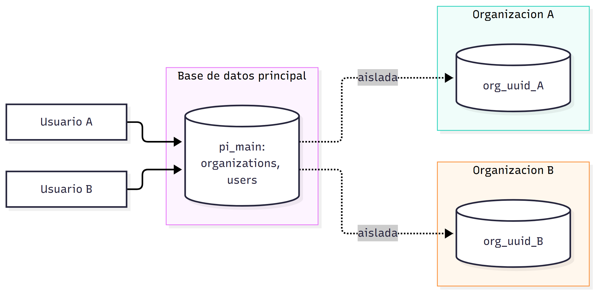
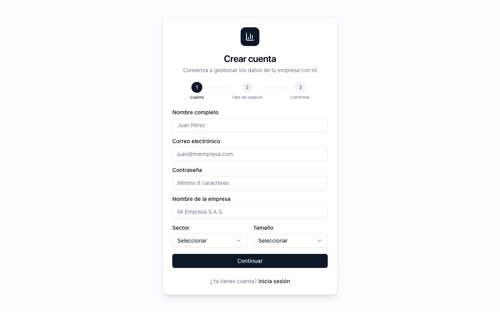
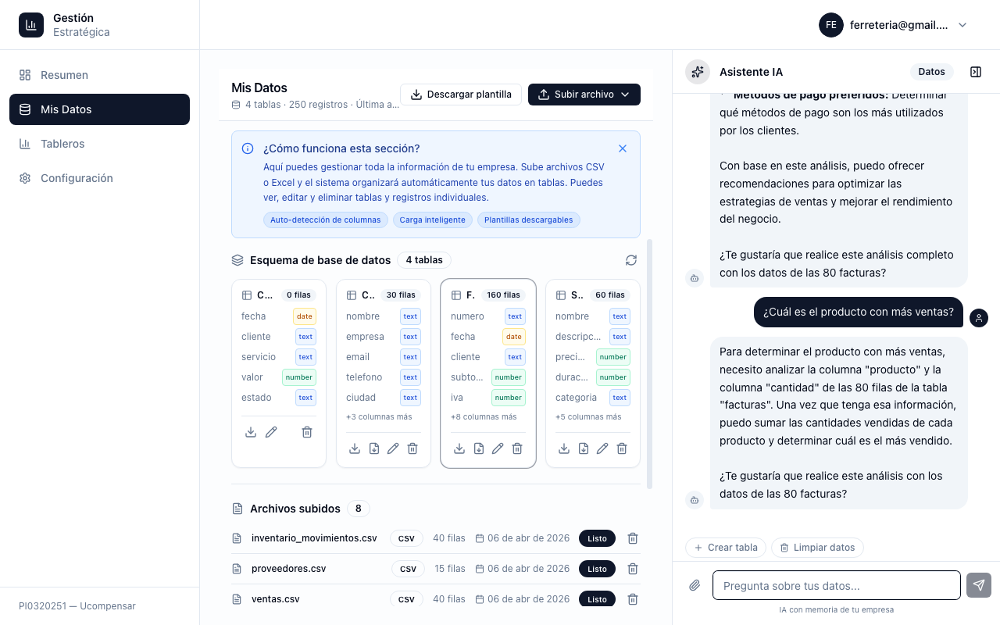
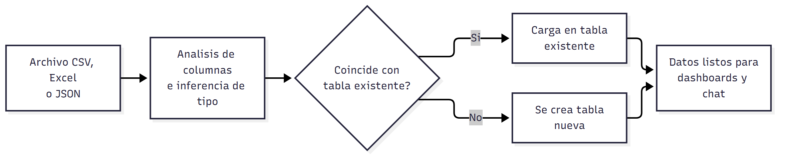
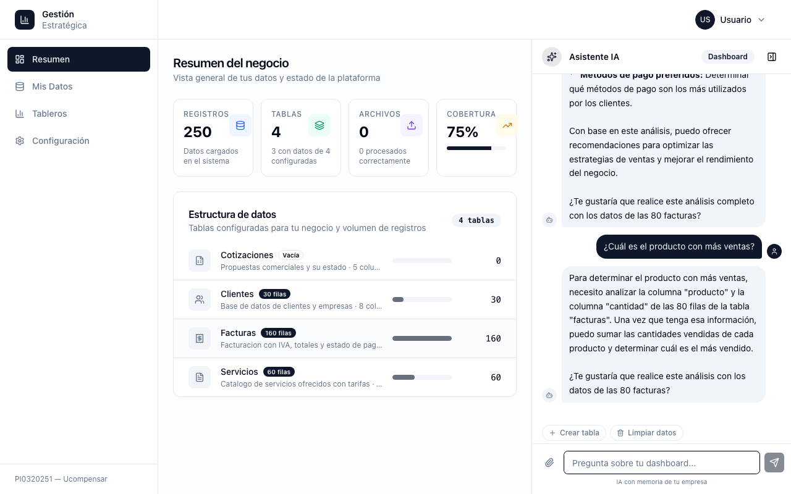
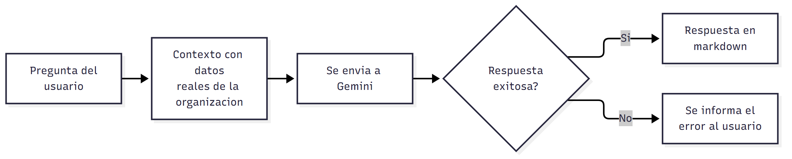

# Investigación y desarrollo de una plataforma SaaS multi-tenant para la gestión estratégica de datos con inteligencia artificial en PYMEs colombianas

**Código del proyecto**: PI0320251
**Semillero de investigación** — Fundación Universitaria Ucompensar
**Autores**: Juan David Celis Venegas, John Steven Arevalo Solorzano, Carlos Alberto Castellanos Garzon, David Santiago Valencia Blanco
**Fecha**: octubre de 2026

---

## Resumen

Las pequeñas y medianas empresas (PYMEs) colombianas generan y acumulan datos operativos (ventas, inventario, servicios) en formatos dispersos, como hojas de cálculo y archivos CSV, sin capacidad técnica ni presupuesto para convertirlos en información útil para la toma de decisiones. Este trabajo presenta el diseño e implementación de una plataforma SaaS multi-tenant que permite a una PYME subir sus datos en su formato original (CSV, Excel con varias hojas, JSON), obtener tableros de control generados automáticamente y consultar esos datos mediante un asistente conversacional en lenguaje natural. La investigación aborda dos preguntas: (1) qué modelo de lenguaje (LLM) es viable para un proyecto académico con presupuesto limitado, y (2) qué funciones del sistema deben resolverse con inteligencia artificial y cuáles con métodos determinísticos, para controlar el costo y la confiabilidad del producto. Se compararon, a partir de sus reportes técnicos, Google Gemini, OpenAI GPT-4, Anthropic Claude y la familia LLaMA como alternativa de código abierto, bajo criterios de costo de entrada, madurez del kit de desarrollo y estabilidad del modelo. Como resultado, se adoptó una arquitectura híbrida: un núcleo determinístico para la ingesta de archivos y la generación de tableros, y un modelo de lenguaje (Gemini, mediante el SDK `google-genai`) restringido a la capa conversacional. El artículo documenta dos hallazgos empíricos —el valor de mantener la función central del producto independiente del proveedor de IA y la obsolescencia acelerada de las versiones de modelo, detectada solo mediante pruebas reales contra la API—, discute las limitaciones del sistema, en particular la del mapeo determinístico frente a columnas renombradas, y plantea como trabajo futuro el uso de modelos de decisión tipada para resolver los casos ambiguos.

**Palabras clave**: inteligencia artificial generativa, arquitectura multi-tenant, grandes modelos de lenguaje (LLM), transformación digital de PYMEs, ingeniería de software, Google Gemini.

---

## 1. Introducción

La transformación digital de la pequeña y mediana empresa en Latinoamérica enfrenta una barrera recurrente: las herramientas de inteligencia de negocios (Business Intelligence) existentes en el mercado —Power BI, Tableau, Looker— están diseñadas para empresas que ya cuentan con un equipo técnico que organice y modele sus datos antes de visualizarlos. Para una PYME colombiana promedio, ese paso de "modelado" es precisamente el que no existe.

Este proyecto de investigación, inscrito como PI0320251 en la Fundación Universitaria Ucompensar, parte de esa brecha y propone una plataforma web que invierte el flujo habitual: en lugar de exigirle al usuario que adapte sus datos a un esquema predefinido, el sistema analiza el archivo que el usuario ya tiene, infiere su estructura y se adapta a ella, y complementa esa capa con un asistente de inteligencia artificial que permite preguntar por los datos en lenguaje natural.

El artículo se organiza así: la sección 2 plantea el problema y las preguntas de investigación; la sección 3 presenta la fundamentación teórica; la sección 4 describe la metodología; la sección 5 reporta los resultados; la sección 6 discute los hallazgos y las limitaciones; y la sección 7 presenta las conclusiones y el trabajo futuro.

---

## 2. Planteamiento del problema

El problema que aborda este trabajo tiene tres dimensiones.

**Brecha tecnológica.** Los datos de una PYME no llegan con una estructura estable. El mismo reporte mensual puede presentar las columnas en otro orden, un nombre de columna escrito de forma distinta, columnas nuevas o columnas que desaparecen. Una herramienta que exige un esquema predefinido traslada al usuario la tarea de normalizar esos datos, que es justamente la capacidad técnica de la que carece. La CEPAL ha documentado las brechas de capacidades que enfrentan las mipymes de la región en su proceso de transformación digital [1].

**Costo.** La inteligencia artificial generativa se cobra por uso: cada consulta consume tokens de entrada y de salida. Para un equipo con presupuesto limitado —y para una PYME que pagaría por el producto— un sistema que invoque un modelo de lenguaje en cada operación tiene un costo operativo que crece con el volumen de datos.

**Confiabilidad.** Un modelo de lenguaje es probabilístico: ante la misma entrada puede producir salidas distintas. Esa propiedad es aceptable al interpretar una pregunta en lenguaje natural, pero no en una operación de infraestructura como decidir en qué tabla se almacena un dato.

De estas tres dimensiones se derivan las preguntas de investigación:

1. ¿Qué modelo de lenguaje es viable para un proyecto académico con presupuesto limitado, considerando el costo de entrada, la madurez del kit de desarrollo y la estabilidad del modelo en el tiempo?
2. ¿Qué funciones del sistema deben resolverse con inteligencia artificial y cuáles con métodos determinísticos, para controlar el costo operativo y la confiabilidad del producto?

---

## 3. Fundamentación teórica

### 3.1 Arquitectura multi-tenant

Una aplicación SaaS multi-tenant atiende a múltiples organizaciones (tenants) con una misma instancia de software, manteniendo aislados los datos de cada una. Guo et al. [2] proponen un marco para el desarrollo y la gestión de aplicaciones multi-tenant nativas, en el que el aislamiento entre tenants es un requisito central. Bezemer y Zaidman [3] advierten que, si bien la multi-tenencia mejora el aprovechamiento de la infraestructura y facilita el mantenimiento, una mala elección arquitectónica puede convertirla en una "pesadilla de mantenimiento". Krebs et al. [4] sistematizan las preocupaciones arquitectónicas de estos sistemas, entre ellas el aislamiento entre tenants, la escalabilidad y la capacidad de personalización. En términos más generales, Kleppmann [5] muestra que las decisiones de particionamiento y aislamiento de los datos condicionan la confiabilidad, la escalabilidad y la mantenibilidad de un sistema intensivo en datos.

### 3.2 Modelos de lenguaje y criterios de evaluación

Los grandes modelos de lenguaje actuales, propietarios y de código abierto, comparten una base común: la arquitectura Transformer, basada exclusivamente en mecanismos de atención [6]. La literatura comparativa suele evaluarlos por su calidad de respuesta en benchmarks generales. Para un proyecto de semillero universitario, sin embargo, la elección debe hacerse bajo restricciones propias del contexto:

| Criterio | Por qué importa en este proyecto |
|---|---|
| **Costo de entrada** | El proyecto no cuenta con presupuesto institucional para consumo de API; depende de un nivel gratuito o de una clave de cortesía. |
| **Madurez del kit de desarrollo (SDK)** | El equipo es pequeño; un SDK maduro en Python, el lenguaje del backend, reduce el tiempo de desarrollo. |
| **Estabilidad y vigencia del modelo** | Un modelo descontinuado obliga a migrar sin aviso, un riesgo que se materializó durante este proyecto (sección 4.3). |
| **Capacidad de contexto** | El asistente necesita recibir como contexto los datos reales de la organización. |
| **Latencia** | El asistente es interactivo; una respuesta de varios segundos degrada la experiencia. |

### 3.3 Comparación de alternativas

| Modelo / proveedor | Ventajas identificadas | Limitaciones para este proyecto |
|---|---|---|
| **Google Gemini** [7] (familia `gemini-*-flash`, vía `google-genai`) | Nivel gratuito permanente mediante Google AI Studio, con límites de solicitudes por minuto y por día [8], suficiente para desarrollo y pruebas; SDK oficial maduro en Python; buen balance entre costo y calidad en la variante "flash". | El uso por encima del nivel gratuito se cobra por token. En el nivel gratuito, Google puede usar el contenido enviado para mejorar sus productos y recomienda no enviar información confidencial [9]. Las versiones "flash" tienen ciclos de vigencia cortos (sección 4.3). |
| **OpenAI GPT-4** [10] | Ecosistema ampliamente documentado, calidad de respuesta consistente, function calling maduro. | En el momento de la evaluación, sin un nivel gratuito sostenido para uso continuo por API: un obstáculo para un proyecto sin presupuesto asignado. |
| **Anthropic Claude** [11] | Alta calidad de razonamiento y buen desempeño en análisis de datos y generación de código. | El mismo obstáculo de costo para uso sostenido; en el momento de la evaluación el equipo no contaba con una clave propia. |
| **Modelos de código abierto** (familia LLaMA [12]) | Sin costo por token; control total de los datos. | Exigen infraestructura de cómputo (GPU) que el equipo no tiene y que no es compatible con el despliegue serverless utilizado. |

### 3.4 Selección y justificación

Se seleccionó **Google Gemini**, en su variante "flash". La decisión no se basó en que sea el modelo de mayor desempeño —las variantes "flash" son, por diseño, versiones ligeras orientadas a costo y latencia, y no las más fuertes en razonamiento complejo— sino en que era la única alternativa que cumplía a la vez las dos restricciones más determinantes: un **nivel gratuito permanente** que permite desarrollar sin pagar y un **SDK oficial maduro en Python**. Ese nivel gratuito reduce la barrera de entrada, pero no elimina el costo: el uso a escala se cobra por token. Esa condición es, precisamente, una de las razones de la arquitectura híbrida descrita en la sección 4.2. La conclusión investigativa es que, para un proyecto académico, la pregunta pertinente no es "cuál modelo es mejor en abstracto", sino "cuál modelo es viable dadas las restricciones reales del equipo que lo va a sostener".

---

## 4. Metodología

### 4.1 Arquitectura general

La plataforma se construyó como una arquitectura **multi-tenant con aislamiento a nivel de base de datos**: cada organización registrada recibe su propia base de datos PostgreSQL (`org_<uuid>`), separada de una base de datos principal (`pi_main`) que contiene únicamente metadatos globales (organizaciones, usuarios, catálogo de tipos de negocio). Atendiendo a la advertencia de Bezemer y Zaidman [3], se priorizó un aislamiento fuerte sobre un esquema compartido con una columna `organization_id` como filtro: no existe ninguna consulta en el sistema que pueda, por error, devolver filas de una organización distinta, porque las organizaciones no comparten base de datos.

El backend está construido en **FastAPI** (Python), con conexiones asíncronas a PostgreSQL mediante `asyncpg`; el frontend, en **Next.js 14** (App Router, TypeScript, TailwindCSS). La autenticación usa JWT propio con cookies `HttpOnly`, sin depender de un proveedor externo de identidad. Frontend y backend se despliegan como servicios independientes [13] en Vercel, con la base de datos PostgreSQL gestionada en Neon.

### 4.2 Núcleo determinístico + IA conversacional

La contribución metodológica central del proyecto es la separación explícita entre dos capas:

1. **Capa determinística (sin IA)**: resuelve la ingesta de archivos y la generación de tableros. Cuando un usuario sube un archivo CSV, Excel (incluidos libros con varias hojas, cada una procesada por separado) o JSON, el sistema: (a) normaliza los nombres de columna (minúsculas, sin espacios en los extremos y con guion bajo en lugar de espacios); (b) infiere con `pandas` el tipo de dato de cada columna; y (c) compara el conjunto de columnas con el de cada tabla existente mediante una puntuación que combina la proporción de columnas con nombre idéntico y la similitud de texto entre nombres, calculada con `SequenceMatcher` del módulo estándar `difflib` (umbral de 0,8 por par de nombres). Si la mejor puntuación alcanza 0,3, los datos se asignan a esa tabla; en caso contrario, se crea una tabla nueva. La generación de tableros aplica reglas heurísticas fijas (columna de texto y columna numérica: gráfica de barras; fecha y numérica: línea; columna categórica: torta) sin invocar ningún modelo de lenguaje.
2. **Capa de IA conversacional**: resuelve únicamente la interacción en lenguaje natural del usuario con sus propios datos —"¿cuánto vendí el mes pasado?", "¿cuál es mi producto más vendido?"—, inyectando los datos reales de la organización como contexto en el prompt enviado a Gemini.

Esta separación tiene una justificación explícita: **un LLM es probabilístico por naturaleza, y una operación de infraestructura (decidir en qué tabla va un dato) debe ser determinística**. Delegar la clasificación de columnas a un LLM habría introducido, además, un costo de tokens proporcional a cada archivo subido y un punto de falla no reproducible. Mantener esa capa determinística significa que la función central del producto (ingerir datos) **nunca consume tokens de IA y nunca falla por una indisponibilidad del proveedor de IA**.

### 4.3 Migración, volatilidad de los modelos y lecciones empíricas

Durante el desarrollo se presentó un hallazgo que, por su valor metodológico, se documenta explícitamente. El modelo `gemini-2.0-flash`, con el que originalmente se integró el asistente conversacional, fue descontinuado por Google. Al intentar migrar a `gemini-2.5-flash` —que la documentación oficial listaba sin fecha de baja anunciada—, la API real, con la clave del proyecto, respondió con un error 404 indicando que el modelo "ya no está disponible para usuarios nuevos", pese a seguir documentado como activo. Solo la migración a una tercera versión (`gemini-3.6-flash`, la alternativa que la propia API sugirió en el mensaje de error) resolvió el problema, lo que se confirmó mediante una llamada real exitosa.

La lección es que **la documentación estática de un proveedor de IA no es, por sí sola, una fuente confiable para decidir qué modelo usar en producción: la validación empírica contra la API real, con la clave real del proyecto, debe ser el criterio final**. Un modelo puede figurar como disponible en la documentación y, al mismo tiempo, estar restringido para claves nuevas o para ciertos niveles de cuota.

Adicionalmente, el SDK `google-generativeai` dejó de tener soporte oficial, lo que obligó a migrar al SDK sucesor `google-genai`, con un patrón de código distinto: de `genai.configure(api_key=...)` y `GenerativeModel(...)` a un cliente explícito `genai.Client(api_key=...)` con `client.models.generate_content(...)` y, para conversación con historial, `client.chats.create(...)`. Como respuesta de diseño, el identificador del modelo quedó definido como un parámetro de configuración (`GEMINI_MODEL`), de modo que un cambio de versión no exige modificar el código; la migración del SDK, en cambio, sí requirió cambios en los servicios que invocan al modelo. Nada garantiza que la versión actual permanezca disponible: **un proyecto que integra IA generativa debe presupuestar mantenimiento recurrente de sus dependencias, no solo el desarrollo inicial**.

---

## 5. Resultados

### 5.1 Arquitectura multi-tenant implementada

El aislamiento por base de datos dedicada está implementado y verificado en producción: cada registro de una nueva organización crea su base de datos (`CREATE DATABASE org_<uuid>`), inicializa su esquema base (tablas de datos subidos, archivos, trabajos de ETL, tableros) y queda operando de forma aislada respecto a cualquier otra organización registrada.

### 5.2 Motor de ingesta de archivos

El endpoint de carga (`smart-upload`) acepta CSV, Excel —incluidos archivos con **varias hojas**, cada una procesada y clasificada de forma independiente— y JSON. Por cada archivo, el sistema decide automáticamente si los datos corresponden a una tabla existente o si debe crear una tabla nueva, sin intervención manual del usuario y sin costo de tokens de IA.

### 5.3 Generación automática de tableros

A partir de cualquier conjunto de datos cargado, el sistema genera automáticamente un tablero con visualizaciones apropiadas al tipo de dato detectado, sin que el usuario tenga que configurar ningún gráfico.

### 5.4 Asistente conversacional

El usuario puede hacer preguntas en lenguaje natural sobre sus propios datos. El asistente construye el contexto del prompt con datos reales de la organización —nunca con datos de otra organización, por el aislamiento descrito en la sección 5.1— y responde usando Gemini. Si la llamada a Gemini falla, el sistema captura el error y lo informa al usuario sin interrumpir la aplicación.

### 5.5 Seguridad

Durante la fase de estabilización se realizó una auditoría que identificó y corrigió cinco hallazgos críticos de la capa de datos y de sesión: una operación de borrado que fallaba sistemáticamente por el uso indebido de una función de agregación en una cláusula `RETURNING`; filas duplicadas de metadatos por la ausencia de una restricción de unicidad; una condición de carrera al crear tablas de forma concurrente; una carga de archivos sin transacción atómica; y un token de renovación de sesión (refresh token) que no se invalidaba al rotarse, lo que permitía reutilizarlo. Los cinco hallazgos fueron corregidos y verificados contra una base de datos real.

---

## 6. Discusión

### 6.1 Hallazgos

El primer hallazgo, a juicio del equipo, es metodológico más que técnico: **la inteligencia artificial generativa no debería ser la respuesta por defecto, sino una herramienta reservada para la parte del sistema donde su naturaleza probabilística es una ventaja (interpretar lenguaje natural ambiguo) y evitada donde es un riesgo (clasificar datos de forma reproducible)**. Esta decisión explica por qué el costo operativo del sistema permanece bajo y predecible aunque crezca el volumen de datos cargados, algo que no ocurriría si cada archivo subido disparara una llamada a un LLM.

El segundo hallazgo es la velocidad del cambio en el ecosistema de IA generativa. En el transcurso de un mismo proyecto académico, el equipo tuvo que cambiar dos veces de versión de modelo y migrar de SDK. La selección de un modelo no puede basarse solo en comparativas publicadas ni en la documentación del proveedor: debe validarse contra la API real, y el sistema debe diseñarse para poder cambiar de modelo con el menor impacto posible.

### 6.2 Limitaciones

- **Mapeo de columnas renombradas.** El mecanismo determinístico identifica la tabla correcta aunque las columnas lleguen en otro orden, con mayúsculas o espacios distintos, con nombres parecidos o con columnas nuevas. Sin embargo, no unifica columnas renombradas: si un mes la columna se llama "cliente" y el siguiente "comprador", el sistema las almacena como dos columnas distintas. La similitud de texto ayuda a encontrar la tabla, pero no fusiona columnas, y un sinónimo no es similar en texto. Tampoco se contemplan archivos cuya fila de encabezados no es la primera, ni hojas con varias tablas.
- **Respuesta de respaldo del asistente.** El código incluye una función de respuesta local para cuando el proveedor de IA no está disponible, pero aún no está conectada a la ruta de producción: hoy el usuario recibe un mensaje de error.
- **Privacidad en el nivel gratuito.** El asistente envía a Gemini una muestra de los datos de la organización. En el nivel gratuito, los términos del servicio permiten a Google usar ese contenido para mejorar sus productos y recomiendan no enviar información confidencial [9]. Un despliegue con datos reales de empresas requiere el nivel de pago.
- **Alcance de la comparación de modelos.** La comparación de la sección 3.3 es documental (reportes técnicos y condiciones de acceso); el equipo no ejecutó un benchmark propio entre los modelos.

---

## 7. Conclusiones y trabajo futuro

Este proyecto demuestra que es posible construir una plataforma de inteligencia de negocios asistida por IA para PYMEs, dentro de las restricciones reales de un semillero de investigación universitario, mediante dos decisiones centrales que responden a las preguntas de investigación: (1) seleccionar el proveedor de IA generativa en función de las restricciones reales del equipo —costo de entrada y madurez del SDK— y no solo de los benchmarks de calidad; y (2) limitar el uso de IA generativa a la capa donde aporta valor genuino (la interpretación del lenguaje natural), resolviendo el resto del sistema con métodos determinísticos, auditables y sin costo de tokens.

La principal línea de trabajo futuro nace de la limitación del mapeo de columnas. Recientemente han aparecido modelos de una categoría distinta a los LLM: modelos de decisión que no generan texto, sino que devuelven una elección entre opciones predefinidas, o un puntaje, con una probabilidad calibrada. Jev, de TypeSafe AI, lanzado en acceso anticipado en 2026, es el primero de los que su creador denomina *System One Models* [14]. Según su creador, responde en 70 a 500 milisegundos y con un costo por token considerablemente menor que el de un LLM; sus salidas siempre respetan el tipo solicitado, aunque eso no garantiza que el valor elegido sea correcto [15]. Un modelo de este tipo podría resolver el caso ambiguo del mapeo —decidir si "comprador" corresponde a "cliente"—, mientras una política determinística acepta la decisión solo si la confianza supera un umbral y, en caso contrario, la remite al usuario. Esta hipótesis no ha sido evaluada por el equipo, y las cifras de desempeño provienen del propio fabricante; evaluarla empíricamente es el siguiente paso natural de la investigación, coherente con su tesis central: inteligencia artificial solo donde aporta valor.

Otras líneas de trabajo futuro son conectar la respuesta local de respaldo del asistente conversacional, incorporar la extracción de datos desde archivos PDF a la ruta de producción, y determinar si un pipeline experimental de agentes de IA para la generación automática de análisis aporta más valor que la combinación actual de tableros determinísticos y chat conversacional.

---

## Referencias

1. Comisión Económica para América Latina y el Caribe — CEPAL (2021). *Transformación digital de las mipymes: elementos para el diseño de políticas*. Naciones Unidas.
2. Guo, C. J., Sun, W., Huang, Y., Wang, Z. H., & Gao, B. (2007). A framework for native multi-tenancy application development and management. En *Proceedings of the 9th IEEE International Conference on E-Commerce Technology and the 4th IEEE International Conference on Enterprise Computing, E-Commerce and E-Services (CEC-EEE 2007)*.
3. Bezemer, C-P., & Zaidman, A. (2010). Multi-tenant SaaS applications: maintenance dream or nightmare? En *Proceedings of the Joint ERCIM Workshop on Software Evolution and International Workshop on Principles of Software Evolution (IWPSE-EVOL)*, Amberes, Bélgica (pp. 88-92). ACM.
4. Krebs, R., Momm, C., & Kounev, S. (2012). Architectural concerns in multi-tenant SaaS applications. En *Proceedings of the 2nd International Conference on Cloud Computing and Services Science (CLOSER 2012)*.
5. Kleppmann, M. (2017). *Designing Data-Intensive Applications: The Big Ideas Behind Reliable, Scalable, and Maintainable Systems*. O'Reilly Media.
6. Vaswani, A., Shazeer, N., Parmar, N., Uszkoreit, J., Jones, L., Gomez, A. N., Kaiser, L., & Polosukhin, I. (2017). Attention is all you need. En *Advances in Neural Information Processing Systems 30 (NeurIPS 2017)* (pp. 5998-6008).
7. Gemini Team, Google (2023). Gemini: A family of highly capable multimodal models. *arXiv preprint arXiv:2312.11805*.
8. Google (2026). *Gemini API: Rate limits*. Google AI for Developers. https://ai.google.dev/gemini-api/docs/rate-limits
9. Google (2026). *Gemini API Additional Terms of Service*. Google AI for Developers. https://ai.google.dev/gemini-api/terms
10. OpenAI (2023). GPT-4 Technical Report. *arXiv preprint arXiv:2303.08774*.
11. Anthropic (2024). *The Claude 3 model family: Opus, Sonnet, Haiku* (Model Card). https://www-cdn.anthropic.com/de8ba9b01c9ab7cbabf5c33b80b7bbc618857627/Model_Card_Claude_3.pdf
12. Touvron, H., Lavril, T., Izacard, G., Martinet, X., Lachaux, M-A., Lacroix, T., Rozière, B., Goyal, N., Hambro, E., Azhar, F., Rodriguez, A., Joulin, A., Grave, E., & Lample, G. (2023). LLaMA: Open and efficient foundation language models. *arXiv preprint arXiv:2302.13971*.
13. Newman, S. (2021). *Building Microservices: Designing Fine-Grained Systems* (2.ª ed.). O'Reilly Media.
14. TypeSafe AI (2026). *Introducing System One Models & Jev*. https://typesafe.ai/blog/introducing-system-one-models-and-jev
15. InfoQ (2026). *TypeSafe AI releases Jev: a decision-only model that returns typed probabilities instead of text*. https://www.infoq.com/news/2026/10/typesafe-ai-jev-released/
