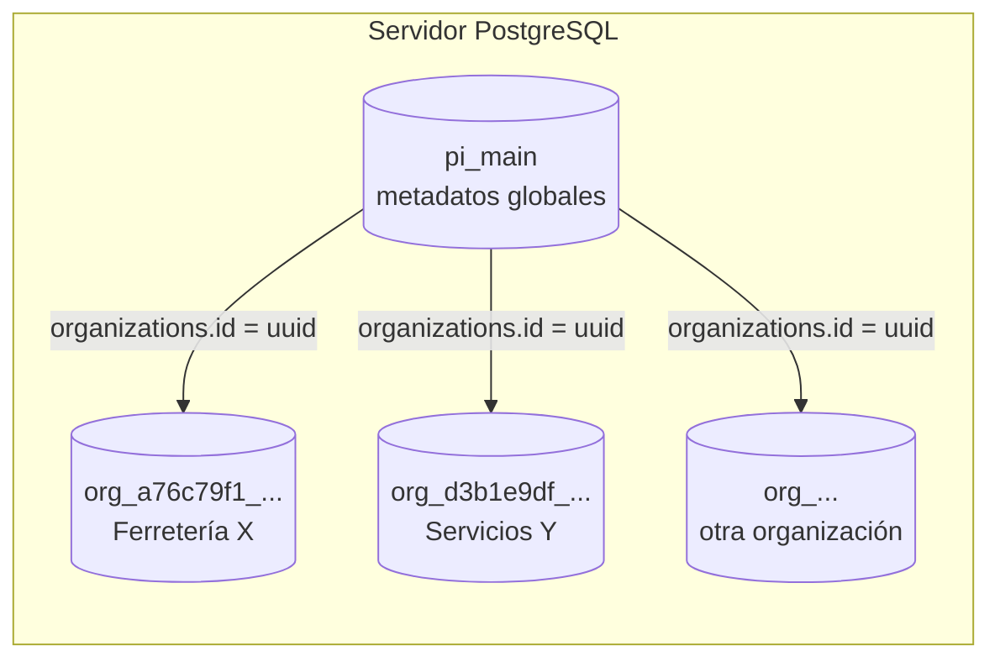
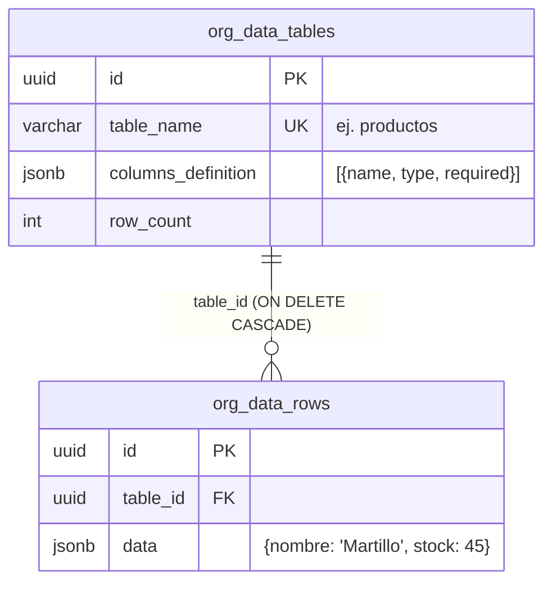

# Diccionario de Datos — PI0320251

**Responsable**: Pasante 2 — Documentación
**Issue relacionado**: #8 (Documentación: diccionario de datos por tipo de negocio)
**Verificado contra**: PostgreSQL 15 local, consultando `information_schema` y `pg_constraint` el 30 de septiembre de 2026 (`main` @ `a90a67c`). Revalidado el 6 de octubre de 2026 (`main` @ `8ba65d7`): sin cambios en `backend/` desde la verificación
**Fuente en código**: `backend/app/database.py`

> Este documento describe el esquema **tal como existe en la base de datos**, no como se planeó. Si el código cambia, hay que volver a ejecutar las consultas de la sección 7 y actualizar este documento.

---

## 1. Visión general: dos niveles de base de datos

El sistema es **multi-tenant con una base de datos física por organización**:



| Base de datos | Cuántas | Contenido |
|---|---|---|
| `pi_main` | 1 | Organizaciones, usuarios y catálogo de tipos de negocio |
| `org_<uuid>` | 1 por organización | Todos los datos de negocio, archivos, chat y tableros de esa organización |

**Regla de nombres**: la base de una organización se llama `org_` + su `id` con los guiones reemplazados por guiones bajos. Ejemplo: la organización `a76c79f1-3a56-4702-9abb-c600ff0a7b2f` usa la base `org_a76c79f1_3a56_4702_9abb_c600ff0a7b2f` (función `_org_db_name`).

**Aislamiento**: no existen llaves foráneas entre `pi_main` y las bases `org_*`. El aislamiento es **físico**: el backend abre un pool de conexiones distinto por organización (`get_org_pool`) usando el `org_id` que viene dentro del JWT del usuario. Una organización no puede consultar la base de otra (verificado en entorno local: un archivo subido por la organización A no aparece en los archivos ni en las tablas de la organización B).

### Concepto clave: las "tablas de negocio" son tablas lógicas

Tablas como `productos`, `ventas` o `facturas` **no son tablas SQL**. Son tablas lógicas:

- Su **definición** (nombre y columnas) es una fila en `org_data_tables`, con las columnas en el campo JSONB `columns_definition`.
- Cada **registro** es una fila en `org_data_rows`, con los valores en el campo JSONB `data`.

Esto permite que el usuario suba un CSV con columnas nuevas y el sistema cree o amplíe una "tabla" sin ejecutar `CREATE TABLE` ni `ALTER TABLE`. En la sección 4 se documentan esas tablas lógicas.



---

## 2. Base de datos principal: `pi_main`

Se crea o actualiza al arrancar el backend (`init_main_db`, en el `lifespan` de `main.py`) con `CREATE TABLE IF NOT EXISTS`. **No hay herramienta de migraciones**: un cambio de columnas en una tabla existente no se aplica solo.

### 2.1 `organizations`

| Columna | Tipo | Nulo | Default | Descripción / validez |
|---|---|---|---|---|
| `id` | uuid | NO | `gen_random_uuid()` | PK. También define el nombre de la base `org_*` |
| `name` | varchar(120) | NO | | Nombre de la empresa. API: 2–120 caracteres |
| `sector` | varchar(50) | sí | `'comercio'` | Sector económico. API: `terciario`, `cuaternario`, `TIC`, `salud`, `educacion`, `comercio` |
| `size` | varchar(20) | sí | `'pequeña'` | API: `micro`, `pequeña`, `mediana`, `grande` (la UI no ofrece `grande`) |
| `nit` | varchar(20) | sí | | NIT. Opcional; la UI actual no lo pide |
| `city` | varchar(50) | sí | `'Bogotá'` | Ciudad |
| `business_type` | varchar(50) | sí | | `ferreteria`, `servicios` o `restaurante`. **Solo** lo escribe `POST /templates/initialize`; queda `NULL` si esa llamada nunca se hace |
| `plan_type` | varchar(20) | sí | `'free'` | `free`, `basic`, `pro`. Hoy siempre `free` |
| `max_records` | integer | sí | `10000` | Límite de registros. Hoy siempre 10000 |
| `created_at` | timestamptz | sí | `now()` | |
| `updated_at` | timestamptz | sí | `now()` | No se actualiza solo (no hay trigger) |

Restricciones: `organizations_pkey PRIMARY KEY (id)`.

> **Diferencia entre `sector` y `business_type`**: son dos campos distintos. `sector` es una clasificación económica (paso 1 del registro). `business_type` determina qué tablas de negocio se crean (paso 2). El Issue #3 surge de confundir los dos.

### 2.2 `users`

| Columna | Tipo | Nulo | Default | Descripción / validez |
|---|---|---|---|---|
| `id` | uuid | NO | `gen_random_uuid()` | PK. Es el `sub` del JWT |
| `email` | varchar(255) | NO | | **Único**. API: formato de correo válido; se rechazan dominios reservados (`.test`, `.local`…) |
| `password_hash` | varchar(255) | NO | | Hash bcrypt (12 rondas). Nunca se devuelve por la API |
| `full_name` | varchar(120) | NO | | API: 2–120 caracteres |
| `org_id` | uuid | NO | | FK → `organizations(id)` **ON DELETE CASCADE** |
| `role` | varchar(20) | sí | `'owner'` | `owner`, `admin`, `viewer`. Hoy todo usuario registrado es `owner` |
| `phone` | varchar(20) | sí | | Editable en perfil |
| `avatar_url` | varchar(500) | sí | | Editable en perfil |
| `preferences` | jsonb | sí | `'{}'` | Preferencias de UI. Editable en perfil |
| `last_login_at` | timestamptz | sí | | Se actualiza en cada login exitoso |
| `created_at` | timestamptz | sí | `now()` | |
| `updated_at` | timestamptz | sí | `now()` | Se actualiza al editar el perfil |

Restricciones: `users_pkey PRIMARY KEY (id)`, `users_email_key UNIQUE (email)`, `users_org_id_fkey FOREIGN KEY (org_id) REFERENCES organizations(id) ON DELETE CASCADE`.

Relación: hoy cada organización tiene exactamente 1 usuario (el que la registró). El modelo permite varios.

### 2.3 `business_types`

Catálogo de tipos de negocio. Se siembra al arrancar (`SEED_BUSINESS_TYPES_SQL`, `ON CONFLICT (name) DO NOTHING`).

| Columna | Tipo | Nulo | Default | Descripción |
|---|---|---|---|---|
| `id` | uuid | NO | `gen_random_uuid()` | PK. **Cambia en cada instalación**: no usar IDs fijos en pruebas, buscar por `name` |
| `name` | varchar(50) | NO | | **Único**. `ferreteria`, `servicios`, `restaurante` |
| `display_name` | varchar(100) | NO | | Texto que ve el usuario |
| `description` | text | sí | | |
| `icon` | varchar(50) | sí | | Nombre de ícono de lucide-react (`Wrench`, `Briefcase`, `UtensilsCrossed`) |
| `schema_definition` | jsonb | sí | `'{}'` | Lista de nombres de tabla. **Informativo**: las columnas reales salen de `BUSINESS_TYPE_TABLES` en `database.py`, no de aquí |
| `default_kpis` | jsonb | sí | `'[]'` | KPIs sugeridos |
| `default_dashboard_config` | jsonb | sí | `'{}'` | Sin uso actualmente |
| `created_at` | timestamptz | sí | `now()` | |

Restricciones: `business_types_pkey PRIMARY KEY (id)`, `business_types_name_key UNIQUE (name)`.

Contenido sembrado:

| name | display_name | KPIs por defecto |
|---|---|---|
| `ferreteria` | Ferretería / Retail | ventas_totales, productos_activos, margen_promedio, rotacion_inventario |
| `servicios` | Empresa de Servicios | ingresos_totales, clientes_activos, cotizaciones_pendientes, tasa_conversion |
| `restaurante` | Restaurante / Alimentos | ventas_diarias, platos_populares, costo_ingredientes, ticket_promedio |

---

## 3. Base de datos por organización: `org_<uuid>`

La crea `create_org_database()` durante el registro, con el esquema base `ORG_BASE_SCHEMA_SQL`. Las 10 tablas siguientes existen en **toda** organización, sin importar su tipo de negocio.

### 3.1 `org_data_tables` — definición de tablas lógicas

| Columna | Tipo | Nulo | Default | Descripción |
|---|---|---|---|---|
| `id` | uuid | NO | `gen_random_uuid()` | PK |
| `table_name` | varchar(100) | NO | | **Único**. Nombre técnico (ej. `productos`) |
| `display_name` | varchar(150) | NO | | Nombre visible (ej. "Productos") |
| `columns_definition` | jsonb | sí | `'[]'` | Arreglo `[{ "name": str, "type": str, "required"?: bool }]`. Ver tipos en 4.4 |
| `row_count` | integer | sí | `0` | Conteo **cacheado** de filas en `org_data_rows`; se recalcula al cargar datos |
| `created_at` | timestamptz | sí | `now()` | |

Restricciones: `org_data_tables_pkey PRIMARY KEY (id)`, `org_data_tables_table_name_key UNIQUE (table_name)`. La restricción UNIQUE se agregó en la Fase 1 (ver `docs/SECURITY.md`, corrección #2). `_dedupe_org_data_tables()` la aplica retroactivamente a bases antiguas.

### 3.2 `org_data_rows` — registros de las tablas lógicas

| Columna | Tipo | Nulo | Default | Descripción |
|---|---|---|---|---|
| `id` | uuid | NO | `gen_random_uuid()` | PK |
| `table_id` | uuid | NO | | FK → `org_data_tables(id)` **ON DELETE CASCADE** |
| `data` | jsonb | NO | `'{}'` | Un registro. Las llaves son los nombres de columna normalizados (minúsculas, espacios → `_`). Los valores nulos del archivo **se omiten** (no se guardan como `null`) |
| `created_at` | timestamptz | sí | `now()` | |
| `updated_at` | timestamptz | sí | `now()` | |

Restricciones: PK y FK. **Sin índice en `table_id`** (ver sección 8, hallazgo H-01).

### 3.3 `uploaded_files` — archivos subidos

| Columna | Tipo | Nulo | Default | Descripción |
|---|---|---|---|---|
| `id` | uuid | NO | `gen_random_uuid()` | PK (el API lo expone como `file_id`) |
| `filename` | varchar(255) | NO | | Nombre de archivo |
| `original_name` | varchar(255) | sí | | Nombre original subido por el usuario |
| `mime_type` | varchar(100) | sí | | Content-Type enviado por el navegador (ej. `text/csv`); `application/octet-stream` si no viene |
| `size_bytes` | integer | sí | `0` | Tamaño |
| `rows_count` | integer | sí | `0` | Filas cargadas |
| `columns_info` | jsonb | sí | `'[]'` | Columnas detectadas y tipos inferidos |
| `file_data` | bytea | sí | | **Copia binaria del archivo** dentro de la BD |
| `status` | varchar(20) | sí | `'uploaded'` | `uploaded` → `ready` o `error` |
| `error_message` | text | sí | | Detalle si `status = 'error'` |
| `created_at` | timestamptz | sí | `now()` | |

> El archivo también se guarda en disco en `backend/uploads/<org_id>/<file_id>_<nombre>` (carpeta excluida de git porque puede contener datos personales de pilotos). En un despliegue serverless (Vercel) ese disco es efímero; la copia que persiste es `file_data`.

### 3.4 `etl_jobs` — trabajos de carga

| Columna | Tipo | Nulo | Default | Descripción |
|---|---|---|---|---|
| `id` | uuid | NO | `gen_random_uuid()` | PK |
| `file_id` | uuid | sí | | FK → `uploaded_files(id)` (sin cascade) |
| `source_type` | varchar(20) | sí | | Tipo de origen |
| `filename` | varchar(255) | sí | | |
| `target_table` | varchar(100) | sí | | Tabla lógica destino |
| `status` | varchar(20) | sí | `'pending'` | `pending`, `processing`, `ready`, `error` |
| `rows_extracted` / `rows_loaded` | integer | sí | `0` | |
| `error_message` | text | sí | | |
| `started_at` / `completed_at` | timestamptz | sí | | |
| `created_at` | timestamptz | sí | `now()` | |

> La carga actual (`POST /api/v1/files/upload`, smart upload) **no** registra filas aquí. Solo las usa el flujo de `/api/v1/etl` (ver sección 8, hallazgo H-03).

### 3.5 `agent_sessions` y `agent_results` — ejecuciones del pipeline de agentes IA

| Tabla | Columnas |
|---|---|
| `agent_sessions` | `id` uuid PK · `user_id` uuid · `file_id` uuid · `status` varchar(20) default `'pending'` · `started_at`, `completed_at` timestamptz · `error_message` text · `gemini_tokens_used` int default 0 · `created_at` |
| `agent_results` | `id` uuid PK · `session_id` uuid FK → `agent_sessions(id)` · `agent_name` varchar(50) · `output` jsonb default `'{}'` · `execution_time_ms` int default 0 · `created_at` |

> Uso pendiente de la decisión del **Issue #1** (reconectar o eliminar el pipeline de insights).

### 3.6 `chat_messages` — historial del asistente

| Columna | Tipo | Nulo | Default | Descripción |
|---|---|---|---|---|
| `id` | uuid | NO | `gen_random_uuid()` | PK |
| `user_id` | uuid | sí | | Autor (sin FK: `users` vive en `pi_main`) |
| `role` | varchar(20) | NO | | `user` o `assistant` |
| `content` | text | NO | | Texto del mensaje (markdown en respuestas) |
| `created_at` | timestamptz | sí | `now()` | |

### 3.7 `dashboards` y `widgets` — tableros

| Columna (`dashboards`) | Tipo | Nulo | Default | Descripción |
|---|---|---|---|---|
| `id` | uuid | NO | `gen_random_uuid()` | PK |
| `name` | varchar(120) | NO | | Nombre del tablero |
| `description` | text | sí | | |
| `is_default` / `is_public` | boolean | sí | `false` | |
| `created_at` / `updated_at` | timestamptz | sí | `now()` | |
| `deleted_at` | timestamptz | sí | | **Borrado lógico**: si tiene valor, el tablero se considera eliminado |

| Columna (`widgets`) | Tipo | Nulo | Default | Descripción |
|---|---|---|---|---|
| `id` | uuid | NO | `gen_random_uuid()` | PK |
| `dashboard_id` | uuid | NO | | FK → `dashboards(id)` **ON DELETE CASCADE** |
| `title` | varchar(120) | NO | | |
| `widget_type` | varchar(30) | NO | | `bar_chart`, `line_chart`, `pie_chart`, `area_chart`, `kpi_card`, `data_table`, `metric`, `text`… |
| `config` | jsonb | sí | `'{}'` | Configuración de la gráfica |
| `position_x`, `position_y` | integer | sí | `0` | Posición en la grilla |
| `width`, `height` | integer | sí | `6`, `4` | Tamaño en la grilla |
| `data_source_query` | jsonb | sí | | Origen de datos del widget |
| `created_at` / `updated_at` | timestamptz | sí | `now()` | |

### 3.8 `data_records` — legacy

| Columna | Tipo | Nulo | Default |
|---|---|---|---|
| `id` | uuid | NO | `gen_random_uuid()` |
| `table_name` | varchar(100) | sí | |
| `data` | jsonb | NO | `'{}'` |
| `created_at` | timestamptz | sí | `now()` |

Tabla de compatibilidad. La carga de datos **sigue escribiendo** cada fila aquí además de en `org_data_rows`. La leen la vista previa de archivos (`GET /api/v1/files/{id}`) y los agentes de `agents/`. Antes de eliminarla hay que resolver esas dependencias (ver sección 8, hallazgo H-02; relacionado con los Issues #1 y #9).

---

## 4. Tablas lógicas por tipo de negocio

Definidas en `BUSINESS_TYPE_TABLES` (`backend/app/database.py`). Se insertan en `org_data_tables` al registrar la organización. **Requerida** = `"required": true` en `columns_definition`.

> **Estado actual (Issue #3)**: por un bug, toda organización recibe hoy las 4 tablas de **Servicios** además de las de su tipo. Lo descrito aquí es el comportamiento **esperado**. Verificado en entorno local el 30 de septiembre: Ferretería y Restaurante quedan con 8 tablas cada una; Servicios queda con 4 (correcto, por coincidencia).

### 4.1 Ferretería / Retail (`ferreteria`)

**`productos`** — "Productos": inventario, precios y stock

| Columna | Tipo | Requerida |
|---|---|---|
| `nombre` | text | Sí |
| `categoria` | text | |
| `precio_compra` | number | |
| `precio_venta` | number | |
| `stock` | integer | |
| `proveedor` | text | |
| `codigo` | text | |

**`ventas`** — "Ventas": transacciones

| Columna | Tipo | Requerida |
|---|---|---|
| `fecha` | date | Sí |
| `producto` | text | Sí |
| `cantidad` | integer | Sí |
| `precio_unitario` | number | |
| `total` | number | |
| `cliente` | text | |
| `metodo_pago` | text | |

**`proveedores`** — "Proveedores"

| Columna | Tipo | Requerida |
|---|---|---|
| `nombre` | text | Sí |
| `contacto` | text | |
| `telefono` | text | |
| `email` | text | |
| `direccion` | text | |
| `productos_suministrados` | text | |

**`inventario_movimientos`** — "Movimientos de Inventario"

| Columna | Tipo | Requerida |
|---|---|---|
| `fecha` | date | Sí |
| `producto` | text | Sí |
| `tipo_movimiento` | text | Sí |
| `cantidad` | integer | Sí |
| `motivo` | text | |

### 4.2 Empresa de Servicios (`servicios`)

**`servicios`** — "Servicios": catálogo con tarifas

| Columna | Tipo | Requerida |
|---|---|---|
| `nombre` | text | Sí |
| `descripcion` | text | |
| `precio_base` | number | |
| `duracion_horas` | number | |
| `categoria` | text | |

**`clientes`** — "Clientes"

| Columna | Tipo | Requerida |
|---|---|---|
| `nombre` | text | Sí |
| `empresa` | text | |
| `email` | text | |
| `telefono` | text | |
| `ciudad` | text | |

**`cotizaciones`** — "Cotizaciones"

| Columna | Tipo | Requerida |
|---|---|---|
| `fecha` | date | Sí |
| `cliente` | text | Sí |
| `servicio` | text | Sí |
| `valor` | number | |
| `estado` | text | |

**`facturas`** — "Facturas": facturación con IVA

| Columna | Tipo | Requerida |
|---|---|---|
| `numero` | text | Sí |
| `fecha` | date | Sí |
| `cliente` | text | Sí |
| `subtotal` | number | |
| `iva` | number | |
| `total` | number | |
| `estado_pago` | text | |

### 4.3 Restaurante / Alimentos (`restaurante`)

**`menu_items`** — "Menú"

| Columna | Tipo | Requerida |
|---|---|---|
| `nombre` | text | Sí |
| `categoria` | text | |
| `precio` | number | Sí |
| `costo` | number | |
| `disponible` | boolean | |

**`pedidos`** — "Pedidos"

| Columna | Tipo | Requerida |
|---|---|---|
| `fecha` | date | Sí |
| `mesa` | text | |
| `items` | text | Sí |
| `total` | number | |
| `metodo_pago` | text | |
| `mesero` | text | |

**`inventario`** — "Inventario" (de ingredientes)

| Columna | Tipo | Requerida |
|---|---|---|
| `ingrediente` | text | Sí |
| `cantidad` | number | |
| `unidad` | text | |
| `costo_unitario` | number | |
| `minimo_stock` | number | |

**`proveedores`** — "Proveedores"

| Columna | Tipo | Requerida |
|---|---|---|
| `nombre` | text | Sí |
| `contacto` | text | |
| `telefono` | text | |
| `productos` | text | |

> `proveedores` existe en Ferretería y en Restaurante con **columnas distintas**. Como `table_name` es único por organización, no hay conflicto mientras cada organización tenga un solo tipo de negocio.

### 4.4 Tipos de dato lógicos y su validez

Los tipos de `columns_definition` **no son tipos SQL**: todo se guarda en JSONB. El tipo es metadata que usan la carga de archivos, los dashboards y el chat.

| Tipo lógico | Se guarda en JSONB como | Regla de inferencia al subir un archivo (`_infer_column_type`) |
|---|---|---|
| `integer` | número | Más del 80 % de los valores son numéricos y todos son enteros |
| `number` | número | Más del 80 % numéricos, con decimales |
| `date` | **texto** (ej. `"2025-07-02"`) | Más del 70 % se interpretan como fecha (día primero) |
| `boolean` | texto | Más del 80 % de los valores en {true, false, si, no, 1, 0, yes} |
| `text` | texto | Cualquier otro caso |

Antes de revisar el contenido, se aplican pistas por **nombre** de columna (`COLUMN_TYPE_HINTS` en `schema_agent_service.py`).

**Importante sobre la validez**: hoy **no se valida** que un registro cumpla con su tabla. Una columna marcada `required` puede faltar, y un `integer` puede contener texto. `columns_definition` describe la intención, no impone reglas. Cualquier consulta que asuma tipos debe tolerar valores faltantes o de otro tipo.

### 4.5 Tablas creadas automáticamente por carga de archivos

Si un archivo no coincide con ninguna tabla existente, el smart upload crea una tabla lógica nueva:

- **Coincidencia**: puntaje = (columnas en común / columnas de la tabla) + 0.1 por cada par de columnas con similitud de texto > 0.8 (`SequenceMatcher`). Se usa la tabla con mayor puntaje si es ≥ 0.3.
- **Nombre de la tabla nueva**: se sugiere por palabras clave (`TABLE_NAME_KEYWORDS`); si nada coincide, `datos_importados`.
- Las columnas nuevas se agregan a `columns_definition` de una tabla existente (`modify_table`).

---

## 5. Ciclo de vida y borrado

| Acción | Efecto en la base |
|---|---|
| Registro | INSERT en `organizations` y `users` (pi_main) → `CREATE DATABASE org_<uuid>` → esquema base → tablas lógicas del tipo |
| Registro fallido | Se borran a mano `users` y `organizations` (compensación, no transacción). La base `org_*` puede quedar creada si falló a mitad |
| Eliminar tabla lógica | DELETE de sus filas en `org_data_rows`, de `data_records` por nombre, y de `org_data_tables` |
| Eliminar organización | **No existe endpoint**. Borrar la fila en `organizations` borra los usuarios (cascade) pero **no** la base `org_*`, que debe eliminarse a mano |

---

## 6. Esquema legacy de Supabase (no usado)

`supabase/migrations/` contiene un esquema anterior (single-database con Row Level Security por `org_id`). **El backend actual no lo usa**: no se aplica en el arranque y la autenticación es JWT propio, no Supabase Auth (commit `aa8172b`). No debe tomarse como referencia del esquema real.

---

## 8. Hallazgos para el equipo de Desarrollo

Observaciones encontradas al verificar el esquema real. No son parte del diccionario, pero afectan cómo se interpretan los datos.

| ID | Hallazgo | Impacto | Relación |
|---|---|---|---|
| H-01 | `org_data_rows.table_id` no tiene índice (solo existe la llave primaria) | Las consultas por tabla lógica (dashboards, chat, conteos) recorren todas las filas de la organización | Rendimiento |
| H-02 | Cada fila cargada se escribe 2 veces: en `org_data_rows` y en la tabla legacy `data_records`. La vista previa de archivos la consulta filtrando por id de archivo, pero la carga guarda el nombre de la tabla, así que la vista previa siempre sale vacía | Duplica almacenamiento y llamadas a la BD; vista previa rota | Issues #1 y #9 |
| H-03 | La carga actual (`/api/v1/files/upload`) no registra filas en `etl_jobs` | El contador "Archivos" del Resumen muestra 0 aunque haya archivos cargados | Bug de interfaz |
| H-04 | El registro crea las tablas de "servicios" además del tipo elegido | Organizaciones con tablas que no corresponden a su negocio | Issue #3 |
| H-05 | `columns_definition` no se valida al cargar datos (`required` y tipos son informativos) | Los consumidores de los datos deben tolerar valores faltantes o de otro tipo | Diseño |

## 7. Cómo verificar este documento

Con el entorno local corriendo (`docker start ucompensar-postgres`):

```bash
# Columnas de pi_main
docker exec ucompensar-postgres psql -U postgres -d pi_main -c "select table_name, column_name, data_type, character_maximum_length, is_nullable, column_default from information_schema.columns where table_schema='public' order by table_name, ordinal_position"
```

```bash
# Bases de organizaciones
docker exec ucompensar-postgres psql -U postgres -d pi_main -c "select datname from pg_database where datname like 'org_%'"
```

```bash
# Restricciones de una base de organización (reemplazar el nombre)
docker exec ucompensar-postgres psql -U postgres -d org_XXXXXXXX_XXXX_XXXX_XXXX_XXXXXXXXXXXX -c "select conrelid::regclass, conname, pg_get_constraintdef(oid) from pg_constraint where connamespace='public'::regnamespace order by 1"
```

```bash
# Tablas lógicas y conteo de filas de una organización
docker exec ucompensar-postgres psql -U postgres -d org_XXXXXXXX_XXXX_XXXX_XXXX_XXXXXXXXXXXX -c "select table_name, display_name, row_count, jsonb_array_length(columns_definition) as columnas from org_data_tables order by table_name"
```
