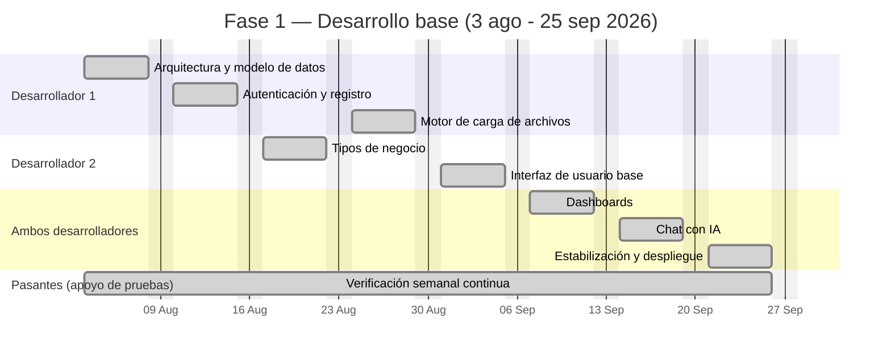
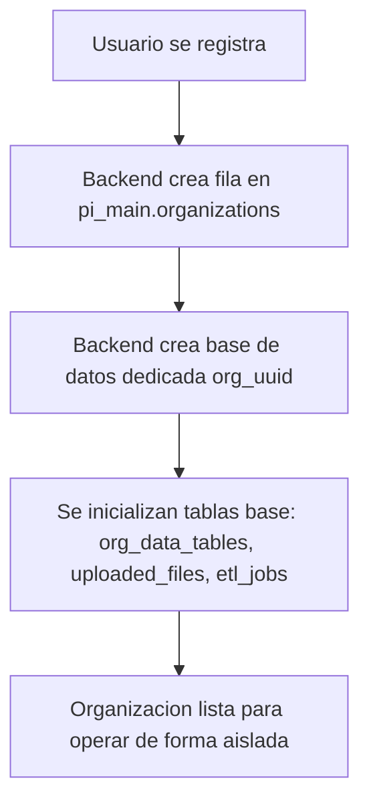
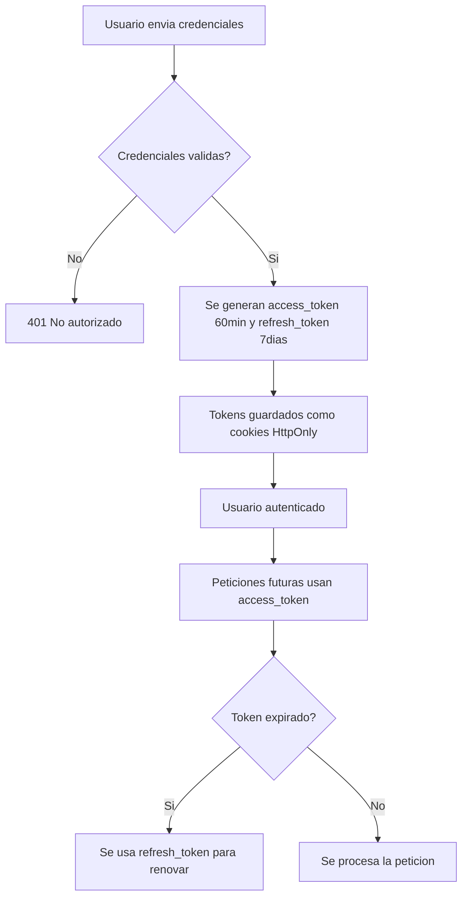
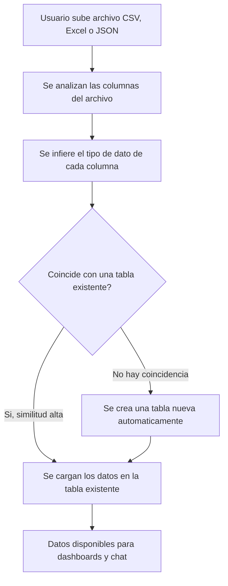
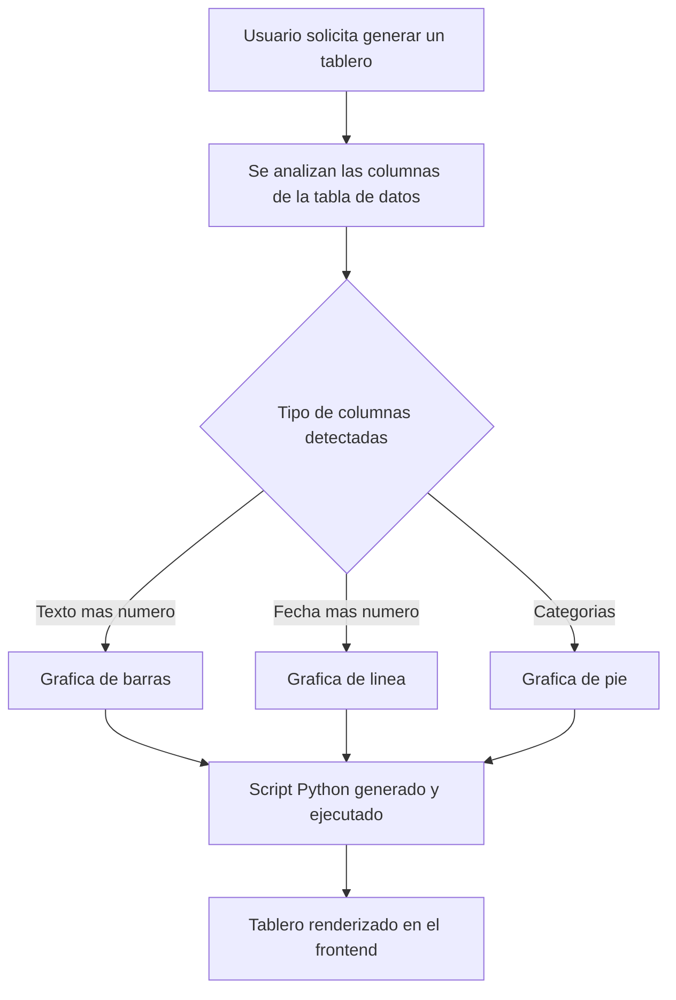
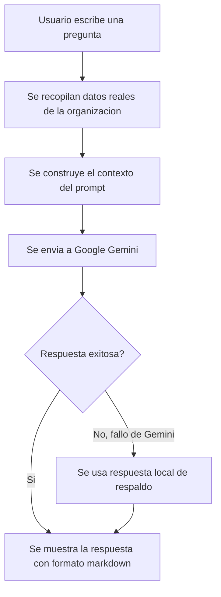
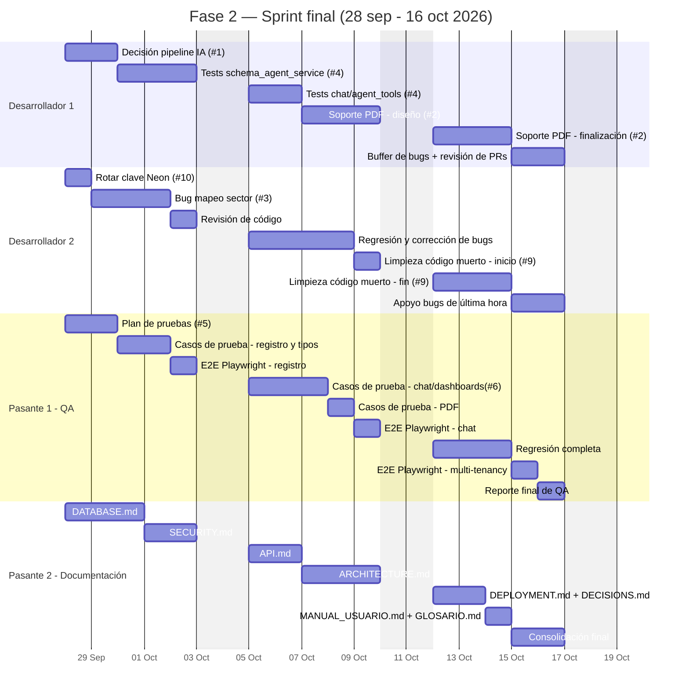

# Plan de Trabajo y Cronograma — PI0320251

**Proyecto**: Solución WEB para la gestión estratégica de datos con IA
**Código**: PI0320251 — Fundación Universitaria Ucompensar
**Última actualización**: 27 de septiembre de 2026

## Equipo

| Rol | Responsabilidad principal |
|---|---|
| Desarrollador 1 (semillerista, líder técnico) | Arquitectura, backend, seguridad, decisiones técnicas de mayor riesgo |
| Desarrollador 2 (semillerista) | Frontend, features de apoyo, revisión de código |
| Pasante 1 — QA / Testing | Diseño y ejecución de pruebas formales, automatización de pruebas de regresión |
| Pasante 2 — Documentación | Documentación técnica completa del sistema |

**Nota sobre la atribución en Fase 1**: los 2 pasantes acompañaron desde esta fase, apoyando en pruebas manuales sobre cada feature a medida que los desarrolladores la iban entregando — no en la metodología formal de casos de prueba que se documenta a partir de la Fase 2 (esa metodología aún no existía), sino como verificación funcional directa. El entregable de esta fase es, ante todo, código: cada semana el equipo construyó y verificó una capa nueva del sistema.

## Metodología de trabajo

- **Fase 1 (3 de agosto – 25 de septiembre)**: desarrollo informal / ad-hoc. El equipo avanzó por capas técnicas en orden de dependencia (arquitectura → autenticación → carga de archivos → dashboards → chat con IA), sin sprints ni ceremonias formales de Scrum — la metodología se formaliza a partir de la Fase 2.
- **Fase 2 (28 de septiembre – 16 de octubre)**: **Scrum real**, con 3 sprints de 1 semana cada uno (Sprint 1, 2 y 3). Cada sprint incluye Sprint Planning, Daily Standup, Sprint Review y Sprint Retrospective. El backlog vive en GitHub Issues (`NiceIam/ucompensar-dashboard-gestion`, issues #1–#10); cada tarea del plan referencia el número de issue correspondiente.

---

# Fase 1 — Desarrollo base (3 de agosto – 25 de septiembre de 2026)

Trabajo realizado sobre la base de código existente del proyecto, en orden de dependencia técnica. Cada semana, mientras los desarrolladores construían, los 2 pasantes apoyaban verificando manualmente esa misma entrega.



## Semana 1 (3–7 de agosto): Arquitectura y modelo de datos



**Desarrollador 1** (código):
- Diseño de la arquitectura multi-tenant: una base de datos PostgreSQL dedicada por organización (`org_<uuid>`), separada de una base de datos principal (`pi_main`) para metadatos globales.
- Definición del esquema de `pi_main`: tablas `organizations`, `users`, `business_types`.
- Definición del esquema base replicado en cada base de datos de organización: `org_data_tables`, `org_data_rows`, `uploaded_files`, `etl_jobs`, `agent_sessions`, `agent_results`, `chat_messages`, `dashboards`, `widgets`.
- Configuración de pools de conexión asíncronos (asyncpg): pool principal (2-10 conexiones), pools por organización (1-5 conexiones), creados bajo demanda.

**Pasante 1 y Pasante 2** (apoyo de pruebas):
- Verificación manual de que cada organización nueva recibe su propia base de datos aislada, y que los datos de una no son visibles desde otra.

**Entregable**: Código (`backend/app/database.py`) + verificación funcional del aislamiento multi-tenant.

## Semana 2 (10–14 de agosto): Autenticación y registro



**Desarrollador 1** (código):
- Implementación de autenticación JWT local (algoritmo HS256), sin dependencia de proveedores externos de auth.
- Endpoints: `POST /api/v1/auth/register`, `POST /api/v1/auth/login`, `POST /api/v1/auth/refresh`, `POST /api/v1/auth/logout`, `GET /api/v1/auth/me`.
- Tokens entregados como cookies HttpOnly (access_token: 60 min; refresh_token: 7 días), nunca expuestos a JavaScript del cliente.
- Rate limiting por endpoint (5/min registro, 10/min login, 30/min renovación) y hashing de contraseñas con bcrypt (12 rondas).

**Pasante 1 y Pasante 2** (apoyo de pruebas):
- Pruebas manuales de registro, login, logout y expiración de sesión; confirmación de que las credenciales inválidas se rechazan correctamente.

**Entregable**: Código (`backend/app/routers/auth_router.py`, `backend/app/services/auth_service.py`, `backend/app/auth.py`) + verificación funcional del flujo de autenticación.

## Semana 3 (17–21 de agosto): Tipos de negocio y esquemas por industria

**Desarrollador 2** (código, con revisión de Desarrollador 1):
- Definición de 3 tipos de negocio soportados: ferretería, servicios, restaurante, cada uno con su propio esquema de tablas (ej. ferretería: productos, ventas, proveedores, inventario_movimientos).
- Flujo de registro en 3 pasos: datos de cuenta → selección de tipo de negocio → confirmación.
- Endpoint `POST /api/v1/templates/initialize`.

**Pasante 1 y Pasante 2** (apoyo de pruebas):
- Registro de prueba con cada uno de los 3 tipos de negocio, verificando que se crean exactamente las tablas correspondientes a cada uno.

**Entregable**: Código (`backend/app/services/template_service.py`, `BusinessTypeSelector`) + verificación de los 3 flujos de tipo de negocio.

## Semana 4 (24–28 de agosto): Motor de carga inteligente de archivos



**Desarrollador 1** (código):
- Desarrollo de `schema_agent_service.py`: análisis automático de columnas de un archivo CSV/Excel/JSON, inferencia de tipo de dato por columna, comparación por similitud de texto contra columnas de tablas ya existentes.
- Creación automática de tabla nueva cuando no hay coincidencia suficiente.
- Endpoint `POST /api/v1/schema/smart-upload`, deliberadamente sin uso de modelos de lenguaje (matching determinístico) para mantener costos y latencia bajos.

**Pasante 1 y Pasante 2** (apoyo de pruebas):
- Carga manual de archivos CSV/Excel de prueba con distintas estructuras de columnas, verificando que el mapeo automático a tablas fuera correcto.

**Entregable**: Código (pipeline de ingesta funcional para CSV/Excel/JSON) + verificación con datos de prueba reales.

## Semana 5 (31 de agosto – 4 de septiembre): Interfaz de usuario base

**Desarrollador 2** (código):
- Configuración de Next.js 14 (App Router), TypeScript, Tailwind CSS y shadcn/ui.
- Páginas de autenticación (login, registro de 3 pasos) y middleware de protección de rutas.
- Cliente HTTP centralizado (`lib/api.ts`) con renovación automática de sesión ante un 401.

**Pasante 1 y Pasante 2** (apoyo de pruebas):
- Navegación manual por las páginas nuevas, verificando que el middleware bloquea el acceso a rutas protegidas sin sesión activa.

**Entregable**: Código (`frontend/src/app/(auth)/*`, `frontend/src/middleware.ts`, `frontend/src/lib/api.ts`) + verificación del flujo de navegación.

## Semana 6 (7–11 de septiembre): Generación automática de dashboards



**Desarrollador 1** (backend) y **Desarrollador 2** (frontend), código:
- Desarrollador 1: `dashboard_script_service.py` — generación heurística de visualizaciones (texto+número → barras, fecha+número → línea, categorías → pie), generación de un script Python descargable por tablero.
- Desarrollador 2: renderizado de gráficas con Recharts, páginas de listado y detalle de tableros.

**Pasante 1 y Pasante 2** (apoyo de pruebas):
- Generación manual de tableros sobre distintos conjuntos de datos de prueba, verificando visualmente que cada tipo de gráfica se renderizara correctamente.

**Entregable**: Código (`frontend/src/app/(dashboard)/dashboards/*`, `chart-renderer.tsx`, `dashboard_script_service.py`) + verificación visual de las gráficas generadas.

## Semana 7 (14–18 de septiembre): Asistente conversacional con IA



**Desarrollador 1** (backend/IA) y **Desarrollador 2** (frontend), código:
- Desarrollador 1: integración con Google Gemini vía `google-genai`; construcción de contexto inyectando datos reales de la organización en el prompt (`agent_tools_service.py`).
- Desarrollador 2: componente de chat flotante con soporte de formato enriquecido (negritas, listas, tablas, encabezados) y respuesta local de respaldo cuando no hay IA disponible.

**Pasante 1 y Pasante 2** (apoyo de pruebas):
- Pruebas manuales del chat con preguntas variadas (directas, ambiguas, fuera de contexto), verificando que el formato de las respuestas se viera correctamente.

**Entregable**: Código (`floating-chat.tsx`, `agent_tools_service.py`, `chat_service.py`) + verificación funcional del chat.

## Semana 8 (21–25 de septiembre): Estabilización, corrección de errores y despliegue a producción

**Desarrollador 1 y Desarrollador 2** (código, trabajo conjunto):
- Auditoría completa del sistema y corrección de 5 errores críticos: eliminación de tabla que fallaba siempre por uso indebido de `RETURNING` con función de agregación; filas duplicadas en metadata de tablas por falta de restricción de unicidad; condición de carrera al crear tablas; carga de archivos sin transacción; token de sesión que no se revocaba al rotarlo.
- Actualización de dependencias críticas: `google-adk` 0.3.0 → 2.9.2; retiro de `google-generativeai` (sin soporte oficial) en favor de `google-genai`; actualización del modelo de Gemini (el anterior fue dado de baja por Google) a `gemini-3.6-flash`.
- Inicialización de control de versiones (Git) y repositorio remoto en GitHub.
- Despliegue en producción: backend y frontend en Vercel (proyectos separados), base de datos en Neon; corrección de compatibilidad SSL y de política de cookies entre dominios distintos.
- Configuración de tablero de seguimiento (GitHub Issues + Projects) con el backlog inicial.

**Pasante 1 y Pasante 2** (apoyo de pruebas):
- Verificación de cada uno de los 5 bugs corregidos (reproducir el error antes del fix, confirmar que ya no ocurre después), y prueba exploratoria del sistema ya desplegado en producción.

**Entregable**: Código (correcciones + configuración de despliegue) + verificación de los 5 bugs corregidos y del sistema en producción; backlog inicial documentado (10 tareas).

---

# Fase 2 — Sprint final (28 de septiembre – 16 de octubre de 2026)

Esta fase se ejecuta bajo **Scrum real**: 3 sprints de 1 semana (Sprint 1, 2 y 3), cada uno con Sprint Planning, Daily Standup, Sprint Review y Sprint Retrospective. Dentro de cada sprint hay tres frentes que avanzan **en paralelo sobre las mismas features**: desarrollo, pruebas formales, y documentación. Ninguno de los tres es independiente de los otros — en cada sprint, QA prueba lo que Desarrollo entregó ese sprint (o el anterior), y Documentación redacta sobre lo mismo.

## Documentos que produce el Pasante de Documentación

Ninguno de estos existe hoy en el proyecto. No es "una arquitectura .md" aislada — son 8 documentos técnicos independientes, cada uno con un propósito distinto, repartidos a lo largo de las 3 semanas:

| # | Documento | Contenido |
|---|---|---|
| 1 | `docs/ARCHITECTURE.md` | Arquitectura real del sistema: qué componentes funcionan en producción, flujo de datos, qué está desconectado o pendiente de decisión |
| 2 | `docs/API.md` | Referencia completa de la API: cada endpoint, sus parámetros, respuestas, códigos de error, con ejemplos reales de solicitud/respuesta |
| 3 | `docs/DATABASE.md` | Diccionario de datos completo: esquema de `pi_main` y de cada tipo de negocio, con tipo de dato y validez de cada columna |
| 4 | `docs/SECURITY.md` | Modelo de seguridad: manejo de JWT, rate limiting, denylist de tokens, política de cookies, y los 5 hallazgos corregidos en la Fase 1 |
| 5 | `docs/DEPLOYMENT.md` | Runbook de despliegue: variables de entorno, pasos para desplegar en Vercel/Neon, procedimiento de rollback, troubleshooting de problemas ya conocidos (SSL, CORS, SameSite) |
| 6 | `docs/DECISIONS.md` | Registro de decisiones de arquitectura (formato ADR): por qué una base de datos por organización y no un esquema compartido, por qué matching determinístico y no un LLM en la carga de archivos, y las decisiones que queden pendientes durante el sprint |
| 7 | `docs/MANUAL_USUARIO.md` | Guía para el usuario final (el administrador de la PYME): cómo registrarse, subir datos, leer un tablero, usar el chat |
| 8 | `docs/GLOSARIO.md` | Términos del dominio del proyecto (multi-tenant, tipo de negocio, matching de columnas, etc.) para que cualquier lector nuevo del proyecto no dependa de adivinar |

## Metodología de pruebas del Pasante de QA

No son checklists sueltos. Cada caso de prueba se documenta en `docs/testing/` con este formato mínimo:

```
ID: TC-XXX
Feature: [a qué funcionalidad pertenece]
Precondición: [estado necesario antes de ejecutar la prueba]
Pasos: [numerados, reproducibles por cualquier persona]
Resultado esperado: [qué debe pasar]
Resultado obtenido: [Pasa / Falla + evidencia]
Severidad si falla: [Crítica / Alta / Media / Baja]
```

Además de pruebas manuales documentadas, el pasante contribuye **pruebas automatizadas reales** usando la infraestructura que el proyecto ya tiene configurada (Playwright para frontend, pytest para backend) — no solo verificación manual repetitiva. Esto es lo que distingue un plan de pruebas de nivel de tesis de una simple lista de verificación.



---

## Sprint 1 (28 de septiembre – 2 de octubre)

**Tema del sprint: estabilidad de la base (multi-tenancy, autenticación, carga de archivos)**

### Ceremonias Scrum

- **Sprint Planning** (lunes 28, primera hora): el equipo completo revisa el backlog de GitHub Issues y confirma el alcance del Sprint 1 — Issues #1, #3, #4 (parte 1), #10, más el arranque de `DATABASE.md` y `SECURITY.md`. Se definen los criterios de aceptación de cada issue antes de empezar a codificar.
- **Daily Standup** (todos los días, 15 min, asíncrono en un hilo de GitHub o canal del equipo): qué hice ayer, qué haré hoy, qué me bloquea.
- **Sprint Review** (viernes 2, tarde): demo de lo construido en la semana — se valida en vivo, con los casos de prueba de Pasante 1, que el Issue #3 (mapeo de sector) y el Issue #10 (rotación de clave Neon) quedaron resueltos.
- **Sprint Retrospective** (viernes 2, después de la review, 15-20 min): qué funcionó bien, qué no, máximo 2 acciones concretas para el Sprint 2.

### Desarrollador 1

- **Lunes–martes — Issue #1**: decisión sobre el pipeline de IA de insights automáticos (reconectar o eliminar), documentada en el issue.
- **Miércoles–viernes — Issue #4 (parte 1)**: pruebas automatizadas para `schema_agent_service.py` (creación de tablas, carga de CSV).

### Desarrollador 2

- **Lunes (primera hora) — Issue #10**: rotar contraseña de Neon y actualizar variable en Vercel.
- **Martes–jueves — Issue #3**: corregir el mapeo roto de sector → tipo de negocio en el registro.
- **Viernes**: revisión de código de Desarrollador 1.

### Pasante 1 — QA/Testing

- **Lunes–martes**: redactar `docs/testing/PLAN_DE_PRUEBAS.md` (metodología, alcance, formato de caso de prueba) — este documento define cómo se van a probar TODAS las features del sprint, no solo esta semana.
- **Miércoles–jueves**: escribir y ejecutar casos de prueba formales (TC-001 a TC-010 aprox.) para: registro de organización con los 3 tipos de negocio, y la corrección del Issue #3 que entrega Desarrollador 2 — confirmar que ya no se generan tablas duplicadas.
- **Viernes**: escribir la primera prueba automatizada en Playwright (`frontend/e2e/`) que cubra el flujo completo de registro, para que quede como prueba de regresión permanente (no solo un checklist manual que se vuelve a hacer a mano cada vez).

### Pasante 2 — Documentación

- **Lunes–miércoles**: `docs/DATABASE.md` — diccionario de datos completo de los 3 tipos de negocio (ferretería, servicios, restaurante), documentando el esquema real verificado contra la base de datos, no contra la memoria de lo que "debería" ser.
- **Jueves–viernes**: `docs/SECURITY.md` — documentar el modelo de autenticación/JWT y los 5 errores de seguridad corregidos en la Fase 1 (con causa raíz de cada uno).

---

## Sprint 2 (5–9 de octubre)

**Tema del sprint: chat con IA, dashboards, y una feature nueva (PDF)**

### Ceremonias Scrum

- **Sprint Planning** (lunes 5, primera hora): revisión de lo que quedó pendiente del Sprint 1 (bugs reportados por QA) y confirmación del alcance del Sprint 2 — Issue #4 (parte 2), Issue #2 (inicio de soporte PDF), inicio del Issue #9.
- **Daily Standup** (todos los días, 15 min, asíncrono): qué hice ayer, qué haré hoy, qué me bloquea — con atención especial a si el soporte de PDF (Desarrollador 1) está listo a tiempo para que Pasante 1 pueda probarlo el jueves.
- **Sprint Review** (viernes 9, tarde): demo del chat con IA, de los dashboards, y de la primera versión de extracción de PDF; revisión de los bugs de regresión corregidos por Desarrollador 2.
- **Sprint Retrospective** (viernes 9, después de la review, 15-20 min): qué funcionó bien, qué no, máximo 2 acciones concretas para el Sprint 3 (el sprint de cierre).

### Desarrollador 1

- **Lunes–martes — Issue #4 (parte 2)**: pruebas automatizadas para `chat_service.py` y `agent_tools_service.py`, incluyendo el caso donde falla Gemini (debe usar respuesta local, no romper).
- **Miércoles–viernes — Issue #2 (inicio)**: diseño e implementación de extracción de tablas desde PDF, integrada a `smart-upload`.

### Desarrollador 2

- **Lunes–jueves**: pruebas de regresión y corrección de bugs reportados por QA en la semana 1.
- **Viernes — Issue #9 (inicio)**: identificar, con Desarrollador 1, qué hooks y componentes de frontend no tienen ningún uso real.

### Pasante 1 — QA/Testing

- **Lunes–miércoles**: casos de prueba formales (TC-011 a TC-025 aprox.) para el chat con IA (preguntas ambiguas, verificación de formato markdown en las respuestas) y para la generación de dashboards (tablero sin datos, actualización tras borrar una tabla).
- **Jueves**: casos de prueba para la extracción de PDF que entrega Desarrollador 1 esta semana — incluir al menos un PDF mal formado como caso negativo.
- **Viernes**: segunda prueba automatizada en Playwright cubriendo el flujo de chat, y reporte semanal de bugs con severidad asignada.

### Pasante 2 — Documentación

- **Lunes–martes**: `docs/API.md` — referencia completa de los endpoints de chat, dashboards y schema, con ejemplos reales de solicitud/respuesta (tomados de pruebas contra el entorno de producción).
- **Miércoles–viernes**: `docs/ARCHITECTURE.md` — mapa completo de qué funciona en producción, qué está desconectado, y la resolución tomada en el Issue #1.

---

## Sprint 3 (12–16 de octubre)

**Tema del sprint: cierre, regresión completa, y consolidación**

### Ceremonias Scrum

- **Sprint Planning** (lunes 12, primera hora): confirmación del alcance de cierre — finalización del Issue #2 (PDF), finalización del Issue #9 (limpieza de código muerto), regresión completa de QA, y consolidación de los 8 documentos.
- **Daily Standup** (todos los días, 15 min, asíncrono): qué hice ayer, qué haré hoy, qué me bloquea — en este sprint, prioridad a cualquier bug crítico que la regresión de QA encuentre, ya que no hay un sprint siguiente para corregirlo.
- **Sprint Review** (viernes 16, tarde): demo final del sistema completo frente al equipo — soporte de PDF terminado, resultado de la regresión completa, y los 8 documentos entregados y enlazados desde el `README.md`. Es también el cierre de la Fase 2 y del sprint final del proyecto.
- **Sprint Retrospective** (viernes 16, después de la review, 15-20 min): retrospectiva de todo el sprint final — qué funcionó bien, qué no, y lecciones para el trabajo futuro del equipo más allá de esta entrega.

### Desarrollador 1

- **Lunes–miércoles — Issue #2 (finalización)**: completar soporte de PDF, manejo de errores cuando no hay tablas reconocibles.
- **Jueves–viernes**: corrección de bugs críticos reportados por QA durante la regresión final; revisión de todos los Pull Requests pendientes del sprint.

### Desarrollador 2

- **Lunes–miércoles — Issue #9 (finalización)**: remover el código muerto identificado, confirmar build y tests en verde.
- **Jueves–viernes**: apoyo a Desarrollador 1 en corrección de bugs de última hora.

### Pasante 1 — QA/Testing

- **Lunes–miércoles**: regresión completa — reejecutar TODOS los casos de prueba de las semanas 1 y 2 sobre la versión final del sprint, más casos nuevos para el soporte de PDF terminado.
- **Jueves**: tercera prueba automatizada en Playwright (regresión de multi-tenancy: dos organizaciones no pueden ver datos una de la otra) y ampliar la suite de pytest del backend para los módulos identificados sin cobertura (`schema_agent_service.py`, `chat_service.py`).
- **Viernes**: `docs/testing/REPORTE_FINAL_QA.md` — resumen ejecutivo de las 3 semanas: casos ejecutados, bugs encontrados, bugs corregidos, bugs que quedan pendientes y su severidad.

### Pasante 2 — Documentación

- **Lunes–martes**: `docs/DEPLOYMENT.md` (runbook de despliegue) y `docs/DECISIONS.md` (decisiones de arquitectura clave del proyecto, formato ADR).
- **Miércoles**: `docs/MANUAL_USUARIO.md` y `docs/GLOSARIO.md`.
- **Jueves–viernes**: consolidación final — revisar los 8 documentos entregados durante el sprint, verificar que estén enlazados desde el `README.md`, y que reflejen el estado real del sistema al 16 de octubre (no lo que se planeó, sino lo que efectivamente quedó construido).

---

## Seguimiento

El estado de avance día a día se sigue en GitHub Issues (`NiceIam/ucompensar-dashboard-gestion`), no en este documento — este documento es el plan; GitHub Issues es el estado real y actualizado. Los 8 documentos de esta fase y los casos de prueba formales quedan en `docs/` como entregables permanentes del proyecto, no solo como evidencia de que se trabajó.
