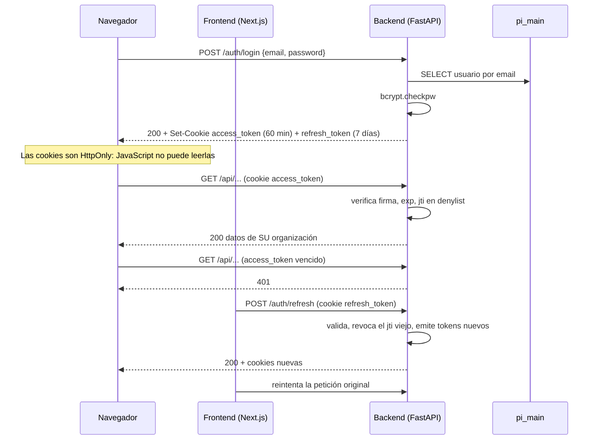

# Modelo de Seguridad — PI0320251

**Responsable**: Pasante 2 — Documentación
**Revisado contra**: código de `main` @ `a90a67c` y pruebas en entorno local (30 de septiembre de 2026). Revalidado el 6 de octubre de 2026 (`main` @ `8ba65d7`): sin cambios en `backend/` ni en la autenticación del frontend
**Archivos principales**: `backend/app/auth.py`, `backend/app/routers/auth_router.py`, `backend/app/services/auth_service.py`, `backend/app/config.py`, `backend/main.py`, `frontend/src/middleware.ts`, `frontend/src/lib/api.ts`

Este documento describe **cómo está protegido el sistema hoy**, qué se corrigió en la Fase 1 y qué riesgos conocidos quedan abiertos. No es una auditoría de penetración.

---

## 1. Resumen

| Control | Implementación | Verificado |
|---|---|---|
| Autenticación | JWT propio (HS256), sin proveedor externo | Sí, entorno local |
| Transporte del token | Solo cookies HttpOnly; el header `Authorization: Bearer` **no** se acepta | Sí, entorno local |
| Contraseñas | bcrypt con 12 rondas (configurable 10–15) | Código |
| Revocación | Denylist en memoria por `jti` (logout y rotación de refresh) | Código; ver riesgo R-01 |
| Fuerza bruta | Rate limiting por IP en registro, login y refresh | Código |
| Aislamiento de datos | Una base de datos PostgreSQL por organización | Sí, entorno local |
| CORS | Lista blanca de orígenes con credenciales | Código |
| Documentación de la API | `/docs`, `/redoc` y `/openapi.json` deshabilitados en producción | Código |

---

## 2. Autenticación con JWT

### 2.1 Flujo

### 2.2 Tokens

| Token | Duración | Claims | Uso |
|---|---|---|---|
| `access_token` | `JWT_EXPIRE_MINUTES` (60 min por defecto) | `sub` (user_id), `org_id`, `email`, `role`, `exp`, `jti` | Toda petición autenticada |
| `refresh_token` | 7 días (fijo en código, ver R-08) | `sub`, `type: "refresh"`, `exp`, `jti` | Solo `POST /api/v1/auth/refresh` |

- **Algoritmo**: HS256 con `APP_SECRET_KEY`. Al arrancar, el backend **rechaza** claves de menos de 32 caracteres o valores triviales (`secret`, `changeme`, `dev-secret-key-change-in-production`…), en `config.py → _validate_secret`.
- **`org_id` dentro del token**: es lo que decide a qué base de datos se conecta cada petición. Por eso la firma del token es la frontera de aislamiento entre organizaciones: quien conozca `APP_SECRET_KEY` puede firmar tokens para cualquier organización.
- **`jti`** (identificador único): permite revocar un token concreto antes de que expire.

### 2.3 Endpoints de autenticación

| Endpoint | Límite | Descripción |
|---|---|---|
| `POST /api/v1/auth/register` | 5/min por IP | Crea organización + usuario + BD. Fija cookies |
| `POST /api/v1/auth/login` | 10/min por IP | Fija cookies. **No** devuelve tokens en el cuerpo |
| `POST /api/v1/auth/refresh` | 30/min por IP | Rota ambos tokens y revoca el refresh anterior |
| `POST /api/v1/auth/logout` | — | Revoca access y refresh (denylist) y borra cookies |
| `GET /api/v1/auth/me` | — | Perfil básico |
| `GET/PUT /api/v1/auth/profile` | — | Perfil detallado / edición |

### 2.4 Mensajes de error

- Login con correo inexistente o contraseña incorrecta → **el mismo** `401 "Credenciales incorrectas."` (no revela si el correo existe). Verificado en entorno local.
- Registro con correo existente → `400 "El correo ya está registrado."`. Esto **sí** permite saber si un correo está registrado (enumeración de usuarios). El límite de 5/min lo mitiga parcialmente. Riesgo aceptado, R-04.

---

## 3. Cookies

Configuradas en `auth_router.py → _set_auth_cookies`:

| Atributo | `access_token` | `refresh_token` |
|---|---|---|
| `HttpOnly` | Sí | Sí |
| `Path` | `/` | `/api/v1/auth/refresh` (solo viaja a ese endpoint) |
| `Max-Age` | 3600 s | 604800 s (7 días) |
| `SameSite` | `COOKIES_SAMESITE` (`strict` por defecto) | igual |
| `Secure` | Ver tabla siguiente | igual |

**Regla de `Secure`** (`config.py → cookies_secure_effective`):

| Condición | `Secure` |
|---|---|
| `COOKIES_SAMESITE=none` | Siempre `true` (los navegadores descartan `SameSite=None` sin `Secure`) |
| `COOKIES_SECURE` definido | El valor definido |
| Ninguno de los anteriores | `true` solo si `APP_ENV=production` |

**Por qué `SameSite` es configurable**: en producción, frontend y backend están en dos proyectos de Vercel distintos. `*.vercel.app` está en la Public Suffix List, así que cada subdominio es un "sitio" distinto para el navegador. Con `strict` o `lax` la cookie nunca viajaría en los `fetch()` del frontend, y por eso producción requiere `none`. Ver el riesgo R-02 sobre CSRF.

---

## 4. Contraseñas

- Hash con **bcrypt**, `BCRYPT_ROUNDS=12` por defecto. El backend no arranca con valores fuera del rango 10–15.
- La API solo exige **mínimo 8 caracteres** (una contraseña de 6 caracteres recibe 422); no hay reglas de complejidad.
- `password_hash` nunca se devuelve por la API. La edición de perfil usa una **lista blanca** de campos (`full_name`, `phone`, `avatar_url`, `preferences`): intentar cambiar `password_hash`, `role`, `org_id` o `deleted_at` devuelve 422 (cubierto por `backend/tests/test_auth_service.py`).
- **No existe** flujo de recuperación ni de cambio de contraseña.

---

## 5. Aislamiento entre organizaciones (multi-tenancy)

- Cada organización tiene su **propia base de datos** `org_<uuid>` (ver `docs/DATABASE.md`).
- El backend elige la base con el `org_id` del token **firmado**, nunca con un parámetro que envíe el cliente.
- No hay consultas que crucen bases de organizaciones.
- Verificado en entorno local: la organización B no ve los archivos ni los datos subidos por A.

---

## 6. Revocación de tokens (denylist)

`backend/app/auth.py` mantiene `_token_denylist: dict[jti → exp]`:

- **Logout**: agrega el `jti` del access y del refresh token.
- **Refresh**: agrega el `jti` del refresh token usado. Si alguien intenta reutilizar un refresh token ya rotado, recibe `401 "Refresh token revocado."` (detección de robo).
- Las entradas vencidas se purgan solas al agregar nuevas.

**Limitación conocida** (documentada en el propio código): la denylist **vive en memoria del proceso**. No sobrevive reinicios ni se comparte entre procesos o instancias. Ver R-01.

---

## 7. Otras protecciones

| Protección | Detalle |
|---|---|
| CORS | `CORS_ORIGINS` (lista separada por comas), `allow_credentials=True`, métodos y headers explícitos |
| Swagger en producción | Deshabilitado si `APP_ENV=production` |
| SQL injection | Consultas parametrizadas con asyncpg (`$1, $2…`). Los nombres de columna dinámicos del perfil pasan por lista blanca. El nombre de la BD de organización (`CREATE DATABASE "org_..."`) se deriva de un UUID generado por Postgres, nunca de entrada del usuario |
| Protección de rutas (frontend) | `middleware.ts` solo redirige a `/` si ya hay sesión y se abre `/login` o `/register`. La protección real de las páginas privadas es el chequeo contra `GET /auth/me` en `(dashboard)/layout.tsx` (ver corrección del commit `bbef48f`). Los datos los protege el backend en todo caso |
| Renovación de sesión (frontend) | `lib/api.ts`: ante un 401 hace **un solo** refresh compartido entre peticiones concurrentes y reintenta |
| Caché del cliente | `signOut` limpia la caché de TanStack Query para que un usuario B no vea datos de un usuario A en el mismo navegador |
| Secretos | `.env` y `.env.local` excluidos de git (`.gitignore`) |

---

## 8. Hallazgos corregidos en la Fase 1

En la semana 8 de la Fase 1 (21–25 de septiembre) el equipo auditó el sistema y corrigió 5 errores críticos. Estas correcciones son **anteriores a la creación del repositorio Git** (primer commit: 22 de septiembre), por lo que no tienen commits individuales. Cada una se rastreó en el código actual, donde quedó un comentario explicativo.

### #1 — Eliminar una tabla fallaba siempre

| | |
|---|---|
| **Síntoma** | `DELETE /api/v1/schema/tables/{id}` siempre respondía con error |
| **Causa raíz** | La consulta usaba `DELETE ... RETURNING count(*)`. PostgreSQL no permite funciones de agregación dentro de `RETURNING` |
| **Corrección** | `DELETE ... RETURNING id` y contar las filas devueltas en Python |
| **Dónde** | `backend/app/services/schema_agent_service.py → delete_table` |
| **Categoría** | Disponibilidad / integridad |

### #2 — Filas duplicadas en la metadata de tablas

| | |
|---|---|
| **Síntoma** | La misma tabla lógica (ej. `productos`) aparecía varias veces, y los datos quedaban repartidos entre copias |
| **Causa raíz** | `org_data_tables.table_name` no tenía restricción `UNIQUE`. El `INSERT ... ON CONFLICT DO NOTHING` no tenía un conflicto real que detectar, así que no evitaba duplicados |
| **Corrección** | `table_name UNIQUE` en el esquema, más `_dedupe_org_data_tables()`, que en bases ya existentes fusiona duplicados (reasigna las filas a la copia con más datos, sin borrar datos) y agrega la restricción |
| **Dónde** | `backend/app/database.py → ORG_BASE_SCHEMA_SQL`, `_dedupe_org_data_tables` |
| **Categoría** | Integridad de datos |

### #3 — Condición de carrera al crear tablas

| | |
|---|---|
| **Síntoma** | Dos cargas casi simultáneas podían crear la misma tabla dos veces |
| **Causa raíz** | Patrón "consultar si existe → insertar" (*check-then-act*): entre la consulta y el insert, otra petición podía insertar |
| **Corrección** | Un único `INSERT ... ON CONFLICT (table_name) DO NOTHING RETURNING ...` atómico, apoyado en la restricción de la corrección #2 |
| **Dónde** | `backend/app/services/schema_agent_service.py → create_table` |
| **Categoría** | Concurrencia / integridad |

### #4 — Carga de archivos sin transacción

| | |
|---|---|
| **Síntoma** | Si una fila fallaba a mitad de un archivo, las filas anteriores quedaban cargadas: datos parciales sin aviso claro |
| **Causa raíz** | Cada `INSERT` se confirmaba por separado |
| **Corrección** | Todos los inserts del archivo y la actualización de `row_count` van dentro de `conn.transaction()`: todo o nada |
| **Dónde** | `backend/app/services/schema_agent_service.py → load_csv_to_table` |
| **Categoría** | Integridad de datos |

### #5 — El refresh token no se revocaba al rotarlo

| | |
|---|---|
| **Síntoma** | Tras usar un refresh token para obtener uno nuevo, el viejo **seguía siendo válido** el resto de sus 7 días |
| **Causa raíz** | `/auth/refresh` emitía tokens nuevos sin invalidar el anterior |
| **Impacto** | Un refresh token robado servía para generar sesiones durante una semana, aunque el usuario legítimo siguiera rotando el suyo |
| **Corrección** | Al rotar, el `jti` del refresh token usado entra en la denylist. Si se reutiliza, se responde `401 "Refresh token revocado."` |
| **Dónde** | `backend/app/routers/auth_router.py → refresh_token` |
| **Categoría** | Seguridad de sesión |
| **Limitación** | Depende de la denylist en memoria (R-01) |

---

## 9. Riesgos conocidos y abiertos

| ID | Riesgo | Severidad | Estado / propuesta |
|---|---|---|---|
| R-01 | **Denylist en memoria en un despliegue serverless.** En Vercel cada petición puede caer en una instancia distinta. Un logout o una rotación registrados en una instancia no se conocen en las demás: el access token puede seguir siendo válido hasta 60 min tras el logout, y la corrección #5 no protege entre instancias | Alta | Propuesto como issue de decisión: tabla `revoked_tokens` en `pi_main`, Redis administrado, o aceptar el riesgo y registrarlo en `docs/DECISIONS.md` |
| R-02 | **CSRF con `SameSite=None`.** Si producción usa `COOKIES_SAMESITE=none`, el navegador envía las cookies en peticiones originadas desde **cualquier** sitio. CORS impide leer la respuesta, pero no impide que se ejecuten las peticiones "simples": un formulario HTML `multipart/form-data` (como `POST /api/v1/files/upload`) no dispara preflight. No hay token anti-CSRF ni verificación del header `Origin` | Media | **A verificar** en producción. Mitigaciones posibles: verificar `Origin`/`Referer` en métodos que modifican datos, o servir frontend y backend bajo el mismo dominio para volver a `lax`/`strict` |
| R-03 | **Rate limiting por IP detrás de un proxy.** `slowapi` usa `get_remote_address` (IP de la conexión). Detrás del proxy de Vercel podría verse la IP del proxy y no la del cliente: o todos los usuarios comparten el límite, o el límite deja de proteger. Además, el contador está en memoria por instancia | Media | **A verificar** en producción |
| R-04 | **Enumeración de correos en el registro** (`400 "El correo ya está registrado."`) | Baja | Aceptado; mitigado por el límite de 5/min |
| R-05 | **Sin política de contraseñas ni recuperación de cuenta.** Solo mínimo 8 caracteres; sin "olvidé mi contraseña" ni cambio de contraseña | Baja | Fuera del alcance de la Fase 2 |
| R-06 | **Rotación pendiente de la contraseña de la BD de producción (Neon)** | Alta | Issue #10, Sprint 1 — Desarrollador 2. Al cerrarlo, documentar aquí el motivo y la fecha de rotación |
| R-07 | **Datos personales de pilotos en archivos subidos.** Se guardan en `uploaded_files.file_data` (BYTEA) y en disco (`backend/uploads/`), sin cifrado a nivel de aplicación | Media | Documentado. Depende del cifrado en reposo del proveedor (Neon) |
| R-08 | **`JWT_REFRESH_EXPIRE_DAYS` no se usa al firmar el refresh token.** `create_refresh_token` usa `timedelta(days=7)` fijo, mientras la cookie usa la variable: si se cambia, cookie y JWT vencen en fechas distintas | Baja | Usar `settings.JWT_REFRESH_EXPIRE_DAYS` en `create_refresh_token` |

---

## 10. Variables de entorno relacionadas con seguridad

| Variable | Default | Producción |
|---|---|---|
| `APP_SECRET_KEY` | — (obligatoria, ≥ 32 caracteres) | Generar con `python -c "import secrets; print(secrets.token_urlsafe(48))"`. **Rotarla invalida todas las sesiones** |
| `APP_ENV` | `development` | `production` (deshabilita Swagger y activa `Secure` por defecto) |
| `JWT_EXPIRE_MINUTES` | `60` | |
| `JWT_REFRESH_EXPIRE_DAYS` | `7` | Solo afecta a la cookie, no al JWT (R-08) |
| `BCRYPT_ROUNDS` | `12` | 10–15 |
| `CORS_ORIGINS` | `http://localhost:3000` | URL exacta del frontend |
| `COOKIES_SAMESITE` | `strict` | `none` si frontend y backend están en dominios distintos |
| `COOKIES_SECURE` | derivado | Solo forzar a `false` en despliegues sin TLS |
| `DATABASE_SSL` | `false` | `true` para Neon |
| `GOOGLE_API_KEY` | vacío | Secreto. Nunca en el frontend |
